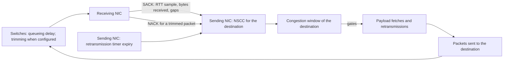

The Scala MRC NIC limits the data it has in flight to each destination with NSCC, a congestion window driven by queueing delay, trims, and losses.

This page follows the congestion signals a sending NIC receives and how they move its window. The NIC's congestion control is NSCC (Network Signal-based Congestion Control), from section 3.6.13 of the UET 1.0 specification. [Transport](./transport.md) explains the SACKs, NACKs, and timers that carry the signals, [Multipath](./multipath.md) how the same signals steer packet spraying, [Buffers and PCIe](./buffers-and-pcie.md) the buffers that limit sending alongside the window, and [Configuration](./configuration.md#scalamrcnscc) every attribute's type and default.

## Overview

NSCC is window-based. It caps the bytes the NIC has in flight to each destination, and there is no pacing and no sending rate: a packet the window admits is fetched and sent as soon as the transmit scheduler reaches it. The window moves on three signals, all of which reach the sender from the network or the receiver:

1. **SACKs.** Each selective acknowledgement reports the bytes the receiver has newly received, and usually gives the sender a round-trip time (RTT) sample. At the default `MSS` the receiver sends one SACK for each data packet ([Selective acknowledgements](./transport.md#selective-acknowledgements)).
2. **Trim NACKs.** A NACK for a data packet that a switch trimmed to its headers ([NACKs](./transport.md#nacks)).
3. **Presumed losses.** A packet the sender presumes lost, either from a gap in the SACKs ([Loss detection from SACK gaps](./transport.md#loss-detection-from-sack-gaps)) or because its retransmission timer expired ([Retransmission timer and retry budget](./transport.md#retransmission-timer-and-retry-budget)).

Cumulative ACKs release bytes in flight, but they run none of NSCC's routines ([Cumulative acknowledgements](./transport.md#cumulative-acknowledgements)). Switches add queueing delay as their queues build, and trim packets when trimming is configured ([Packet trimmer](../scala-switch/configuration.md#packet-trimmer)).



Three behaviors are worth knowing before anything else:

- **The window starts at its maximum.** There is no slow start: a new destination may have a full max window in flight at once, limited by the egress buffer and the PCIe fetch rather than by the window ([Egress buffer](./buffers-and-pcie.md#egress-buffer)).
- **Delay alone does not shrink the window on a SACK.** Every routine a SACK can take grows the window, whatever its delay sample. On delay, only [Quick Adapt](#quick-adapt) shrinks the window, and only with `TrimmingEnabled` `false`; it reacts to one SACK's sample, not to an average.
- **Each presumed loss takes one packet off the window.** A packet presumed lost from a SACK gap or a timer expiry shrinks the window by its nominal size, and so does each trim NACK unless Quick Adapt acts on it instead ([Loss reactions](#loss-reactions)).

## Key concepts

| Term | Meaning |
| --- | --- |
| Nominal packet | The IP datagram of a data packet: its payload plus 60 bytes of headers, or plus 64 with `WireTimestamp`, 4,156 bytes for a full packet at the defaults. Bytes in flight count each packet at its nominal size. A full packet of `MSS` + 60 bytes is the unit of the window's floor and of `MaxCongestionWindow` in either `RTTTimestampMode`. The 18 bytes of Ethernet header and frame check sequence are not counted ([Packets on the wire](./transport.md#packets-on-the-wire)). |
| Congestion window | The most bytes the NIC may have in flight to one destination, counted in nominal packet sizes. It is a byte count, not a whole number of packets. |
| Bytes in flight | Nominal bytes of the packets the NIC has fetched or replayed for the destination that the receiver has not yet reported received, and that have not been NACKed or presumed lost. A new packet counts from the moment its payload fetch is issued, a retransmission from the moment it is replayed. |
| SACK | The receiver's selective acknowledgement. Besides the packets it acknowledges, it reports the bytes the receiver has received for the first time, and a service time that the sender's RTT sample leaves out. |
| Base RTT | NSCC's estimate of the path's RTT without queueing. It starts at `ConfigBaseRTT`, and any lower RTT the NIC measures replaces it. It can only fall. |
| BDP | Bandwidth-delay product: the NIC's link rate times `ConfigBaseRTT`, in bytes. 300,000 bytes at the defaults. |
| Max window | The ceiling of the congestion window: 1.5 × BDP by default. The window also starts there. |
| Target queue delay | The queueing delay NSCC aims for: 0.75 × `ConfigBaseRTT` with `TrimmingEnabled` `true`, the default, or `ConfigBaseRTT` with it `false`. |
| Queueing delay sample | How far one SACK's RTT sample lies above the base RTT. Never below 0. |
| Average queueing delay | A moving average of the samples, with `DelayAlpha` as the weight of the newest one. |

## The congestion window

NSCC keeps one congestion window per destination. With `QPGroupsEnabled` set to `true`, the default, every queue pair (QP) from the NIC to one destination address belongs to one group, and the group has one window, one base RTT, and one Quick Adapt state; with `false`, each QP has its own ([QP groups and the transmit scheduler](./transport.md#qp-groups-and-the-transmit-scheduler)). The Chakra workload opens a new QP for each message, so with `false` each message starts with a window of its own. A group's window lasts as long as the group, which lives while any QP to or from the destination is open: once none is, the next message to it starts a new window at the max window, with a base RTT of `ConfigBaseRTT`.

The window gates every payload fetch and every retransmission. The NIC fetches a new segment's payload, or replays a retransmission, only while the bytes in flight to the destination are below the window. The packet's own size is not part of the test, so the bytes in flight can pass the window by less than one nominal packet. A segment counts as in flight from the moment its payload fetch is issued, before it reaches the wire, so the window bounds the data fetched and not yet sent together with the data sent and not yet acknowledged.

A packet leaves the bytes in flight when a SACK reports it received, when it is NACKed, or when it is presumed lost; a cumulative ACK also releases the bytes it confirms. A SACK reports the bytes received in 256-byte steps, counting packets that arrived out of order, so a packet that overtakes a lost one on another path leaves flight with the SACK that reports its arrival.

The window also decides which data packets ask the receiver for a cumulative ACK. Besides the last packet of each message and every retransmission, a data packet asks for one when, as its payload arrives from the host, the window has less than one nominal packet of room or is smaller than 4,095 bytes ([Cumulative acknowledgements](./transport.md#cumulative-acknowledgements)).

The window starts at the max window, and there is no slow start. The max window comes from the BDP, or from `MaxCongestionWindow` when `OverrideSpecMaxCongestionWindow` is `true`:

```text
BDP          = link rate × ConfigBaseRTT ÷ 8
max window   = 1.5 × BDP                                    (OverrideSpecMaxCongestionWindow false, the default)
max window   = MaxCongestionWindow × nominal packet         (OverrideSpecMaxCongestionWindow true)
```

The link rate is the rate the NIC's link runs at: its `DataRate`, or the rack switch's downlink `DataRate` if that is lower ([UplinkNetworkInterface](./configuration.md#uplinknetworkinterface)). The window never goes below one nominal packet, and never above the max window except briefly after the max window falls ([Base RTT](#base-rtt)).

## Base RTT

The base RTT starts at `ConfigBaseRTT`. Three kinds of RTT sample are offered to it: the samples from SACKs, the samples from NACKs, and the samples from the responses to reliability probes, which the NIC sends only on paths it has marked bad after a timeout ([Path feedback and probes](./multipath.md#path-feedback-and-probes)).

**How a sample is taken.** With the default `RTTTimestampMode`, `LocalDatabase`, a SACK's sample runs from the end of serialization of the transmission that drew it to the SACK's arrival, less the service time the receiver reports, which is 0 at the defaults. A SACK gives a sample when that packet is still unacknowledged and was sent once, or when the SACK answers its first retransmission. A NACK's sample, when it gives one, has no service time taken off. With `WireTimestamp`, the samples come from a timestamp the data packets carry. [RTT measurement](./transport.md#rtt-measurement) explains both modes and the service time.

**How the base RTT changes.** Any sample below the current base RTT becomes the new base RTT. The base RTT never rises. When it drops:

- Each SACK or NACK with an RTT sample derives the max window again from the base RTT, as 1.5 × link rate × base RTT ÷ 8, and each SACK with an RTT sample lowers a window above it to it. A base RTT lowered by a probe response takes effect on the max window at the next such sample. With `OverrideSpecMaxCongestionWindow` set to `true`, the max window never follows the base RTT: it stays at `MaxCongestionWindow` nominal packets for the life of the window.
- Quick Adapt's observation window, one base RTT plus the target, shortens with it.
- The target queue delay and the gains of the increase routines keep the values they took from `ConfigBaseRTT`, and the increases are still applied on the `ConfigBaseRTT` period ([How the window responds to each SACK](#how-the-window-responds-to-each-sack)). The Quick Adapt delay threshold, when it applies, is set by `QuickAdaptThreshold` alone and does not change.
- Queueing delay samples are measured against the new base RTT.

**Choosing `ConfigBaseRTT`.** It sets the BDP, the max window, and the default target for every destination of the NIC, so set it to the unloaded RTT of the longest path the NIC's traffic takes, and no destination meets the second case below:

- **Above the unloaded RTT,** the first samples lower the base RTT to the measured RTT, and the max window shrinks to 1.5 times the BDP of the measured path. The target and the gains keep their larger `ConfigBaseRTT` values. On a destination whose unloaded RTT is well below `ConfigBaseRTT`, the max window settles well below its starting value; `base_rtt_ns` in the records shows the base RTT the NIC reached ([Records](#records)).
- **Below the unloaded RTT,** no sample ever lowers the base RTT, so the part of every RTT above `ConfigBaseRTT` reads as queueing delay on every SACK, even on an idle path. The max window, sized from `ConfigBaseRTT`, can then be smaller than the bytes needed to keep the link busy over the real round trip.

## Target queue delay

The target is the queueing delay NSCC tries to hold. It is set once, when a destination's window is created, and does not follow a lower measured base RTT.

| `TrimmingEnabled` | `OverrideSpecTargetQueueDelay` | Target queue delay |
| --- | --- | --- |
| `true` (default) | `false` (default) | 0.75 × `ConfigBaseRTT`: 4.5 µs at the defaults |
| `false` | `false` | `ConfigBaseRTT`: 6 µs at the defaults |
| Either | `true` | `TargetQueueDelay` |

`TrimmingEnabled` is the `ScalaMrcQpManager` attribute that also marks the NIC's data packets trimmable ([Packet marking](./transport.md#packet-marking)). It sets the operating point UET 1.0 section 3.6.13.3 defines: the lower target with trimming on, and, as [Quick Adapt](#quick-adapt) explains, no delay trigger.

Besides deciding which routine each SACK takes, the target sets the scale of proportional increase and, with the base RTT, the length of Quick Adapt's observation window. The default `TargetQueueDelay`, 4,500 ns, equals the target trimming gives at the default `ConfigBaseRTT`; it has no effect unless `OverrideSpecTargetQueueDelay` is `true`. With the override, a `TargetQueueDelay` below `1ns`, `0` included, stops the simulation when the NIC sets up its first queue pair ([Configuration rules that stop a simulation](./configuration.md#configuration-rules-that-stop-a-simulation)).

`TargetQueueDelayMargin` is not a band around the target. It is the test for entering fast increase: only SACKs whose delay sample is below both the margin and the target count toward it ([How the window responds to each SACK](#how-the-window-responds-to-each-sack)).

## How the window responds to each SACK

Only SACKs run NSCC's routines. A cumulative ACK releases the bytes it confirms from the bytes in flight and does nothing else here. Each SACK is processed in this order:

1. **Bytes received.** The bytes the SACK reports newly received leave the bytes in flight, and count toward Quick Adapt's delivered bytes and toward the next application of the increases. A SACK that gives no RTT sample stops here.
2. **Base RTT and queueing delay.** A sample below the base RTT lowers it, and the max window is derived again from the base RTT ([Base RTT](#base-rtt)). The SACK's delay sample is computed and folded into the average:

   ```text
   sample  = RTT − base RTT, and at least 0
   average = DelayAlpha × sample + (1 − DelayAlpha) × average
   ```

3. **Quick Adapt.** If Quick Adapt fires on this SACK, processing stops here ([Quick Adapt](#quick-adapt)).
4. **One routine,** chosen by the SACK's delay sample:

   | Delay sample | Routine |
   | --- | --- |
   | Below the target and below `TargetQueueDelayMargin` | Proportional increase, or fast increase once it is engaged. The SACK counts toward engaging fast increase. |
   | Below the target, and at or above the margin | Proportional increase. Fast increase, if engaged, ends. |
   | At or above the target | Fair increase |

5. **Apply.** Proportional and fair increase add to a pending increase rather than to the window. On the first SACK that comes at least `ConfigBaseRTT` after the additive term was last added, or after the window was created, the pending increase is applied to the window and the additive term is added with it. The pending increase is also applied, without the additive term, once more than eight nominal packets' worth of bytes have been received since it was last applied.
6. **Bounds.** The window is kept between one nominal packet and the max window.

The routines:

- **Proportional increase** grows the window by more the further the delay sample is below the target, and by more the more bytes the SACK reports received. `AlphaMultiplier` scales it.
- **Fast increase** engages once SACKs whose delay samples are below both `TargetQueueDelayMargin` and the target have reported more than a window's worth of bytes received, counted since the last sample between the margin and the target. While it is engaged, each SACK below both grows the window at once, in proportion to the bytes it reports received, scaled by `FastIncreaseMultiplier`, without passing the max window. It ends at the first SACK whose delay sample is at or above the margin and below the target.
- **Fair increase** grows the window steadily, by an amount that does not depend on how far the delay is above the target. `FairIncreaseMultiplier` scales it.
- **Additive term.** A small additive increase scaled by `EtaMultiplier`, added at most once per `ConfigBaseRTT`. A larger value raises the window faster.

`ReferenceNetworkRTT` defines, with a reference link speed fixed at 400 Gbps, a reference BDP that normalizes the proportional, fast, and fair increases and the additive term: those gains grow with the ratio of the NIC's own BDP, from its link rate and `ConfigBaseRTT`, to the reference BDP, so a larger `ReferenceNetworkRTT` makes the NIC's increases smaller. At the defaults the two BDPs are equal; a NIC whose link runs at 200 Gbps, with the other defaults, has half the gains of a 400 Gbps NIC. The reference does not change the target or the max window. A `ReferenceNetworkRTT` below `1ns`, `0` included, stops the simulation when the NIC sets up its first queue pair ([Configuration rules that stop a simulation](./configuration.md#configuration-rules-that-stop-a-simulation)).

None of the routines shrinks the window. When the delay samples are above the target, fair increase keeps the window growing while queues build, until another signal shrinks it. On a SACK, the window shrinks only when Quick Adapt fires, or when a lower base RTT lowers the max window below it; otherwise it shrinks only through the loss reactions ([Loss reactions](#loss-reactions)).

The routines, and Quick Adapt's delay trigger when `TrimmingEnabled` is `false`, act on each SACK's own delay sample. The average queueing delay is what the records report as the path's queueing delay over time ([Records](#records)).

## Quick Adapt

Quick Adapt cuts a destination's window in one step when the window has clearly outrun what the path delivers. It works in observation windows, each one base RTT plus the target queue delay long, 10.5 µs at the defaults. A destination's first observation window opens with its first SACK with an RTT sample or its first trim NACK, so a new destination cannot Quick Adapt before that first window has ended.

After an observation window ends, the first SACK with an RTT sample, or the first trim NACK that Quick Adapt is not ignoring, makes Quick Adapt check two conditions:

1. **A trigger is present:** a trim NACK has arrived since Quick Adapt last fired, or this is a trim NACK, or, with `TrimmingEnabled` `false`, this SACK's queueing delay sample is above `QuickAdaptThreshold`. The delay test uses that one sample, not the average queueing delay. With `TrimmingEnabled` `true`, the default, a SACK's delay is never a trigger, so Quick Adapt can fire only once a trim NACK has arrived since it last fired.
2. **Too few bytes were delivered:** the bytes acknowledged during the observation window are below the max window ÷ 2^`QuickAdaptGate`, with the max window as it stands at that moment.

If both hold, Quick Adapt fires:

- The window is set to the bytes acknowledged during the observation window, and to at least one nominal packet.
- Until as many bytes as were in flight at that moment have been acknowledged, trimmed, or presumed lost, trim NACKs leave the window alone, so the trims of packets sent before the cut do not cut it again.
- The firing is counted in `total_qa_count`.

Either way, a new observation window starts.

The delay threshold, 24 µs by default and used only with `TrimmingEnabled` `false`, is a fixed value: it does not change when `ConfigBaseRTT` or the target does. With `QuickAdaptThreshold` set to `0`, any delay sample above 0 is a trigger. `QuickAdaptGate` sets how deep the fall in delivered bytes must be: at `0`, Quick Adapt fires whenever a trigger is present and less than a max window was acknowledged. With `DisableQuickAdapt` set to `true`, Quick Adapt never runs.

## Loss reactions

**Trim NACK.** When a NACK arrives for a data packet that a switch trimmed, on any hop including the last, and the packet is still unacknowledged:

1. The NACK's RTT sample is offered to the base RTT, the max window is derived again, and `ConfigBaseRTT` is folded into the average queueing delay as one sample.
2. A Quick Adapt trigger is set. Unless Quick Adapt is ignoring trim NACKs, it checks its conditions with this NACK if the observation window has ended.
3. If Quick Adapt did not fire, and is not ignoring trim NACKs, the window shrinks by the trimmed packet's nominal size, to no less than one nominal packet.

The packet is queued for retransmission ([NACKs](./transport.md#nacks)). A trim NACK for a packet that has already been acknowledged leaves the window alone.

**Other NACKs.** A NACK for a packet beyond the receiver's PSN window takes the packet out of flight and queues it for retransmission, but leaves the window alone; its RTT sample still counts toward the base RTT.

**Presumed loss.** When the NIC presumes a packet lost, the window shrinks by the packet's nominal size, to no less than one nominal packet. Quick Adapt does not run on a presumed loss. Two things make the NIC presume a packet lost:

- **A gap in the SACKs.** A packet not yet acknowledged is presumed lost once a SACK reports a packet more than `SACKLossMinRetxPkts` PSNs above it, 512 by default. Each packet is presumed lost this way at most once ([Loss detection from SACK gaps](./transport.md#loss-detection-from-sack-gaps)).
- **A timer expiry.** The packet's retransmission timer expires while it is still unacknowledged and not already queued for retransmission ([Retransmission timer and retry budget](./transport.md#retransmission-timer-and-retry-budget)).

Trim NACKs arrive only when a switch trims the NIC's data packets, which needs the packets marked trimmable ([Packet marking](./transport.md#packet-marking)) and switch trimming turned on, with the switch's UET policy and PFC off on every traffic class ([Packet trimmer](../scala-switch/configuration.md#packet-trimmer)). They come from the receiving NIC only when it is set to send them ([NACKs](./transport.md#nacks)). Without them, the window shrinks through presumed losses and a lower base RTT, and, with `TrimmingEnabled` `false`, through Quick Adapt's delay trigger. The validation warns when a NIC with `TrimmingEnabled` `true` shares the topology with a switch that does not trim ([Configuration rules that stop a simulation](./configuration.md#configuration-rules-that-stop-a-simulation)).

## Turning congestion control off

`PassThrough` set to `true` stops the window from gating anything: payload fetches, new packets, and retransmissions no longer wait for it. NSCC still runs on every SACK, trim NACK, and presumed loss, and the records still show the window moving, but it has no effect on sending. Sending to a destination is then bounded by the egress buffer's data pool, by each QP's PSN window, `MaxPSNRange` ([ScalaMrcQpManager](./configuration.md#scalamrcqpmanager)), and by the PCIe fetch ([Egress buffer](./buffers-and-pcie.md#egress-buffer)).

One side effect shows in the receivers' `total_ack_pkts_tx`: once the bytes in flight come within one nominal packet of the window, every data packet sent has less than one nominal packet of room, so every data packet asks for a cumulative ACK, and the receiver sends a cumulative ACK as well as a SACK for each ([Cumulative acknowledgements](./transport.md#cumulative-acknowledgements)).

No attribute turns NSCC's routines off while keeping the window as a limit. `DisableQuickAdapt` turns off Quick Adapt alone.

## How each attribute shapes the window

All but the last three rows sit in the `ScalaMrcNscc` component and apply to every destination's window on the NIC. [ScalaMrcNscc](./configuration.md#scalamrcnscc) gives each attribute's type and accepted values.

| Attribute | Default | Role |
| --- | --- | --- |
| `PassThrough` | `false` | With `true`, the window no longer limits fetching, sending, or retransmission; NSCC still computes and records it ([Turning congestion control off](#turning-congestion-control-off)). |
| `ConfigBaseRTT` | `6000ns` | Starting base RTT. Sets the BDP and the max window, the default target, the normalization of the increase gains, and the period on which increases are applied. A lower measured RTT replaces it as the base RTT. The max window, Quick Adapt's observation window, and the reference for queueing delay samples then follow the measured value, while the target, the increase gains, and the period keep their `ConfigBaseRTT` values. |
| `AlphaMultiplier` | `4.0` | Scales proportional increase. Higher values give larger increases. |
| `FairIncreaseMultiplier` | `5.0` | Scales fair increase, the routine for SACKs whose delay sample is at or above the target. Higher values give larger increases. |
| `FastIncreaseMultiplier` | `1.0` | Scales fast increase. Higher values give larger increases while it lasts. |
| `EtaMultiplier` | `0.15` | Scales the additive term, added at most once per `ConfigBaseRTT`. At `0` there is no additive term. |
| `DelayAlpha` | `0.25` | Weight of the newest delay sample in the average queueing delay. Higher values make the average follow the samples faster. The routines, and Quick Adapt's delay trigger when it applies, use each SACK's own sample. |
| `QuickAdaptGate` | `3` | Quick Adapt fires only when the bytes acknowledged in an observation window are below the max window ÷ 2^`QuickAdaptGate`. A larger gate lets it fire only after a deeper fall in delivered bytes. |
| `DisableQuickAdapt` | `false` | With `true`, Quick Adapt never runs. |
| `QuickAdaptThreshold` | `24000ns` | With `TrimmingEnabled` `false`, the queueing delay above which one SACK's delay sample triggers Quick Adapt; with `TrimmingEnabled` `true`, the default, not used. A fixed value: it does not follow `ConfigBaseRTT` or the target. |
| `OverrideSpecMaxCongestionWindow` | `false` | With `true`, the max window, and so the starting window, is `MaxCongestionWindow` nominal packets for the life of the window: a lower measured base RTT does not change it. |
| `MaxCongestionWindow` | `107` | The max window in nominal packets, used only with `OverrideSpecMaxCongestionWindow` set to `true`. |
| `OverrideSpecTargetQueueDelay` | `false` | With `true`, the target is `TargetQueueDelay` instead of the value derived from `ConfigBaseRTT` and `TrimmingEnabled`. |
| `TargetQueueDelay` | `4500ns` | The target, used only with `OverrideSpecTargetQueueDelay` set to `true`. It then also sets the scale of proportional increase and the length of Quick Adapt's observation window. |
| `TargetQueueDelayMargin` | `1000ns` | Delay below which SACKs whose delay is also below the target count toward entering fast increase. Not a band around the target. |
| `ReferenceNetworkRTT` | `6000ns` | With a reference link speed fixed at 400 Gbps, the reference BDP that normalizes the proportional, fast, and fair increases and the additive term. A larger value makes those increases smaller. |
| `QPGroupsEnabled` (`ScalaMrcQpManager`) | `true` | With `true`, one window per destination, shared by all the NIC's QPs to it; with `false`, one window per QP, so per message with the Chakra workload, each starting at the max window. |
| `MSS` (`ScalaMrcQpManager`) | `4096` | Sets the window's unit, a full packet of `MSS` + 60 bytes: the unit of the window's floor, of `MaxCongestionWindow`, and of the eight-packet rule for applying increases. It also sets how many data packets each SACK covers ([Selective acknowledgements](./transport.md#selective-acknowledgements)). |
| `TrimmingEnabled` (`ScalaMrcQpManager`) | `true` | Sets the operating point. With `true`, the target is 0.75 × `ConfigBaseRTT` and Quick Adapt has no delay trigger; with `false`, the target is `ConfigBaseRTT` and `QuickAdaptThreshold` applies. `OverrideSpecTargetQueueDelay` `true` replaces the target, not the trigger rule ([Target queue delay](#target-queue-delay)). |

## Worked example: the defaults

A NIC with every attribute at its default: link rate 400 Gbps, `MSS` 4096, `ConfigBaseRTT` 6 µs.

**Window sizes.**

```text
nominal packet          4,096 B payload + 12 B (BTH) + 4 B (METH) + 16 B (RETH) + 8 B (UDP) + 20 B (IPv4)  =   4,156 B
BDP                     400 Gbps × 6 µs ÷ 8                                                                =  300,000 B
max window              1.5 × 300,000 B                                                                    =  450,000 B
                        450,000 B ÷ 4,156 B                                                                =  108.28 nominal packets
starting window         the max window                                                                     =  450,000 B
```

With `OverrideSpecMaxCongestionWindow` set to `true`, the max window is 107 × 4,156 B = 444,692 B, slightly below the derived 450,000 B, and it stays there whatever the base RTT does.

**After the base RTT drops.** Without the override, the max window follows the measured base RTT:

```text
max window              1.5 × 400 Gbps × base RTT ÷ 8         = 75 B for each ns of base RTT
base RTT 1,000 ns       75 B × 1,000                          = 75,000 B, about 18 nominal packets
observation window      1 µs base RTT + 4.5 µs target         = 5.5 µs
Quick Adapt byte threshold  75,000 B ÷ 2^3                    = 9,375 B
```

The target stays 4.5 µs, so the delay samples are measured against the 1 µs base RTT but compared with the 4.5 µs target.

**Target and Quick Adapt.**

```text
target                          0.75 × ConfigBaseRTT                     = 4.5 µs   (TrimmingEnabled true)
fast-increase margin            TargetQueueDelayMargin                   = 1 µs
Quick Adapt triggers            trim NACKs only                                     (no delay trigger)
observation window              6 µs base RTT + 4.5 µs target            = 10.5 µs at the start
Quick Adapt byte threshold      450,000 B ÷ 2^3                          = 56,250 B, about 13.5 nominal packets
increases applied               after 6 µs, or after more than 8 × 4,156 B = 33,248 B received
```

Quick Adapt fires on the first SACK with an RTT sample, or trim NACK, after a 10.5 µs observation window in which fewer than 56,250 bytes were acknowledged, if a trim NACK has arrived. With `TrimmingEnabled` `false`, the target is 6 µs, the observation window 12 µs, and a SACK whose delay sample is above 24 µs is a trigger too. At the default `MSS` the receiver sends a SACK for each data packet, so a NIC sending at full rate to one destination receives a SACK about every 83.48 ns: NSCC runs once for each packet delivered, while the proportional and fair increases reach the window only on the cadence above.

## Records

The default `mrc-transport-stats` record has one row per Scala MRC NIC every `TransportStatsReportInterval`, 1 ms by default, and each row combines every destination on the NIC. Its times are in nanoseconds. These columns show congestion control ([mrc-transport-stats](./records.md#mrc-transport-stats)):

| Columns | What they show |
| --- | --- |
| `*_cwnd_bytes` | The congestion window in bytes, sampled at each SACK received, before that SACK changes it |
| `*_bytes_in_flight` | The bytes in flight, sampled at the same SACKs |
| `calc_*_rtt_ns`, `ivl_calc_*_rtt_ns` | RTT samples: the minimum, maximum, and mean, from each SACK that gives one |
| `*_avg_queue_delay_ns` | The average queueing delay, sampled at each SACK that gives an RTT sample |
| `base_rtt_ns` | The lowest base RTT any window on the NIC has reached so far; 0 before the first sample |
| `total_qa_count`, `ivl_total_qa_count` | Quick Adapt firings, cumulative and in the interval |
| `total_fi_count`, `ivl_total_fi_count` | Steps taken in fast increase, one for each SACK that grew the window that way |
| `total_nack_trimmed_rx`, `total_nack_trimmed_lasthop_rx`, `total_rtx_sack`, `total_rto_events` | The loss signals: trim NACKs received, retransmissions of packets presumed lost from SACK gaps, and timer expiries |

With `EnableMonitor` set to `true`, each per-packet row of the `mrc-monitor` record carries the congestion window and bytes in flight of the QP's destination, and the row of each received SACK that gave an RTT sample carries that sample ([mrc-monitor](./records.md#mrc-monitor)).
