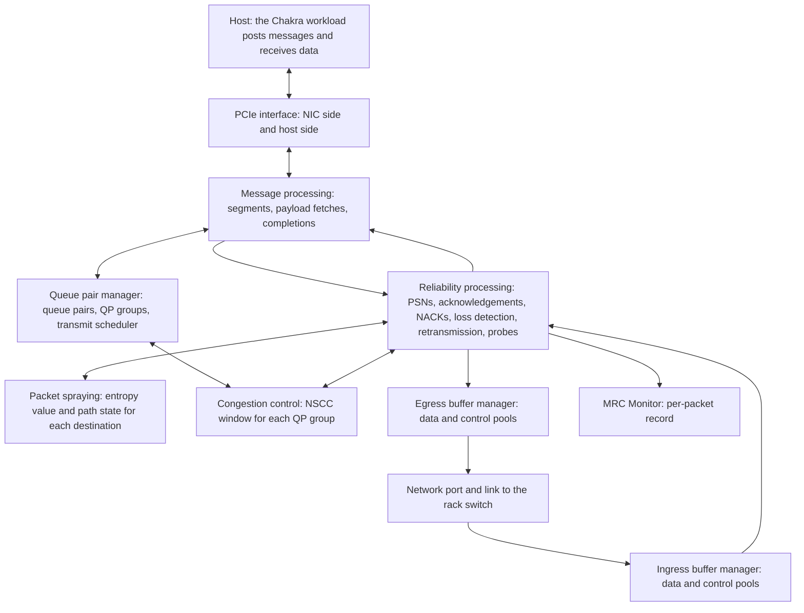

The Scala MRC NIC models a Multipath Reliable Connection (MRC) network interface card with packet spraying, NSCC congestion control, and a PCIe host link.

Model version 4.0.5 is the version these pages describe.

## What this model simulates

The Scala MRC NIC is a generic MRC NIC. A simulation configuration places one on a server, where it serves that one host: it fetches the data the host's application sends from host memory over a PCIe link, carries it across one Ethernet port to the rack switch as MRC packets over IPv4 and UDP, and writes the data it receives back to host memory. Rather than modeling a specific vendor's adapter, it models the mechanisms of the MRC transport: queue pairs with packet sequence numbers, cumulative and selective acknowledgements and NACKs, loss detection from gaps in the selective acknowledgements, retransmission with a retry budget, packet spraying across equal-cost paths with feedback from each path, congestion control driven by queueing delay, trims, and losses, and separate buffer pools for data and control.

The workload that runs over it on the platform is the [Chakra workload](../chakra-workload/index.md).

The results you reason about with it are message completion times, acknowledgements, NACKs, and retransmissions and what caused each, how packet spraying spreads a destination's packets across equal-cost paths and which paths it takes out of use, the congestion window and round-trip times that congestion control works from, receive-buffer drops, and how much of the network link and the PCIe link a workload uses.

Simulations on the platform carry IPv4 traffic.

### What is and is not modeled

- **RDMA Write only.** The host posts each message as an RDMA Write, a one-way transfer of its bytes to a peer. The NIC sends no Write with Immediate, and Send, Read, and Atomic operations are not modeled ([Queue pairs and messages](./transport.md#queue-pairs-and-messages)).
- **Out-of-order placement, in-order completion.** The receiver writes each packet's payload to host memory as it arrives, in order or not, and reports a message received only when its last packet has arrived with no gap before it ([Receiving a packet](./transport.md#receiving-a-packet)).
- **Loss detection from gaps in the selective acknowledgements.** A packet still unacknowledged once a packet more than `SACKLossMinRetxPkts` PSNs beyond it has been selectively acknowledged is presumed lost and retransmitted, without waiting for its timer. Trim NACKs and a per-packet retransmission timer recover the other losses ([Loss detection from SACK gaps](./transport.md#loss-detection-from-sack-gaps)).
- **A retry budget, unlimited by default.** `LinearRetryCount` and `ExponentialRetryCount` bound how often a packet is retransmitted. When a packet's budget runs out, its queue pair enters an error state and its message never completes. At the default `ExponentialRetryCount` of 25, the NIC never gives up ([Retransmission timer and retry budget](./transport.md#retransmission-timer-and-retry-budget)).
- **A congestion window, with no rate pacing.** Congestion control limits the bytes each QP group has in flight; it does not pace packets at a rate ([The congestion window](./congestion-control.md#the-congestion-window)).
- **Scala MRC NIC peers only.** A Scala MRC NIC exchanges traffic only with other Scala MRC NICs: every NIC that sends to or receives from a Scala MRC NIC must be a Scala MRC NIC ([Add the NIC to a server](./configuration.md#add-the-nic-to-a-server)).
- **No priority flow control.** The NIC does not implement PFC: it sends no pause frames, and it does not pause for the pause frames it receives ([Pause frames](./buffers-and-pcie.md#pause-frames)).
- **Wire framing.** Packets carry Ethernet, IPv4, UDP, and the MRC transport headers. The preamble and interframe gap a physical link spends on each frame are not modeled ([Packets on the wire](./transport.md#packets-on-the-wire)).
- **Host memory.** The host answers each PCIe read at once; host memory latency is not modeled ([Fetching the payload over PCIe](./transport.md#fetching-the-payload-over-pcie)).

## Features

- **OCP MRC 1.0 transport.** Each message is an RDMA Write, cut into packets of at most `MSS` bytes and carried on a queue pair with its own packet sequence numbers. The receiver writes packets to host memory as they arrive and answers with cumulative acknowledgements, selective acknowledgements (SACKs), and NACKs; the sender recovers lost packets from trim NACKs, from gaps in the SACKs, and from a per-packet retransmission timer with a retry budget. [Transport](./transport.md) explains it.
- **RoCEv2 framing.** Every packet carries the RoCEv2 base transport header (BTH) in a UDP datagram to destination port 4791, and every data packet carries the RDMA extended transport header (RETH). MRC adds its own headers for SACKs, NACKs, and probes ([Packets on the wire](./transport.md#packets-on-the-wire)).
- **Packet spraying.** Each packet's UDP source port carries an entropy value, which the switches' default ECMP hash includes, so varying it spreads a destination's packets across equal-cost paths. `PacketSprayingType` selects `None` (each queue pair's own port) or `Default Packet Spraying` (the default: a rotation over a random set of ports, which passes over a port once after a NACK reports a packet on it trimmed on the way, and takes a port out of use when a packet sent on it times out, until a probe on it is answered). [Multipath](./multipath.md) explains them.
- **Network Signal-based Congestion Control (NSCC), UET 1.0 section 3.6.13.** Each QP group has a congestion window in bytes. NSCC grows it as SACKs arrive, faster the further the queueing delay above the measured base round-trip time lies below its target. It cuts the window in one step with Quick Adapt when, after a trim NACK (or, with `TrimmingEnabled` `false`, a delay sample above `QuickAdaptThreshold`), little data is getting through, and it shrinks the window on trims, timeouts, and losses found from SACK gaps. [Congestion control](./congestion-control.md) explains the window and each attribute's role.
- **Packet trimming marks.** With `TrimmingEnabled` `true`, the default, data packets carry the trimmable codepoint, so a switch with trimming on cuts a packet it cannot queue down to its headers instead of dropping it. When the sending NIC has the default `RTTTimestampMode`, `LocalDatabase`, a receiving NIC whose own `TrimmingEnabled` is `true` answers a trimmed packet with a NACK, and the sender queues the packet for retransmission ahead of new data ([NACKs](./transport.md#nacks)). Trimming itself is done by switches ([Packet trimmer](../scala-switch/configuration.md#packet-trimmer)).
- **QP groups.** With `QPGroupsEnabled` `true`, the default, the queue pairs to one remote address share one congestion window and take turns in the transmit scheduler as one group ([QP groups and the transmit scheduler](./transport.md#qp-groups-and-the-transmit-scheduler)).
- **DSCP codepoints by packet role, RFC 2474.** The NIC writes a DSCP codepoint that names each packet's role: no-trim or trimmable data, a trimmable retransmission, or control. Switches write the trimmed codepoints, and a switch under the UET policy takes a packet's traffic class from its codepoint, so a switch with `UETPolicyEnabled` `true` accepts the Scala MRC NIC ([Packet marking](./transport.md#packet-marking)).
- **Ingress and egress buffers.** A receive buffer and a transmit buffer, each divided into a data pool and a control pool. Control packets are sent ahead of waiting data. [Buffers and PCIe](./buffers-and-pcie.md) explains them.
- **PCIe host interface.** Each segment's payload is fetched from host memory with one PCIe read, and received data is written to host memory with PCIe writes. The lane rate, the lane count, the transaction-layer buffers, and the size of each read-request message are configurable ([PCIe host interface](./buffers-and-pcie.md#pcie-host-interface)).
- **Statistics and the MRC Monitor.** Transport counters per NIC and device counters for the network port; and, when turned on, queue pair and message lifecycle events and the MRC Monitor's per-packet record, which can be filtered by node, address, or queue pair, with triggers that add a queue pair to the record when it receives a trimmed packet or a NACK, has a retransmission timeout, or enters its error state. [Records](./records.md) lists them.

## Architecture

The NIC is assembled from cooperating components. The queue pair manager keeps the queue pairs and decides which group of them sends next, message processing and reliability processing turn the host's messages into packets and back, packet spraying and congestion control choose each packet's path and how much may be in flight, the buffer managers own the transmit and receive buffers, and the PCIe interface connects the NIC to its host.

| Component | Responsibility | Configured by |
| --- | --- | --- |
| NIC | Holds the other components, and turns the transport counters, the lifecycle events, and the MRC Monitor on and off. | [NIC](./configuration.md#nic) |
| Network port | The NIC's one Ethernet port to its rack switch. Sends frames at the link's rate, the lower of `DataRate` and the rack switch's downlink rate. | [UplinkNetworkInterface](./configuration.md#uplinknetworkinterface) |
| Link | Carries frames between the port and the rack switch with the NIC's propagation delay. | [TransmissionMedium](./configuration.md#transmissionmedium) |
| Ingress buffer manager | Divides the receive buffer into a data pool and a control pool, charges each received packet to its pool until the host write is accepted or the packet has been processed, and drops packets that do not fit. | [IngressBufferManager](./configuration.md#ingressbuffermanager) |
| Egress buffer manager | Divides the transmit buffer into a data pool and a control pool, holds each packet's reservation until it has been sent, and sends control packets ahead of data. | [EgressBufferManager](./configuration.md#egressbuffermanager) |
| Queue pair manager | Creates and tracks queue pairs and QP groups, keeps the groups that are ready to send, and holds the transport settings: segment size, PSN window, trimming marks, loss detection, the retransmission timer and retry budget, RTT measurement, probes, and the spraying type. | [ScalaMrcQpManager](./configuration.md#scalamrcqpmanager) |
| Message processing | Receives the host's events, a new message on a new queue pair or a closed queue pair, cuts each message into segments of at most `MSS` bytes, requests each segment's payload over PCIe, and reports send and receive completions. | Settings in [ScalaMrcQpManager](./configuration.md#scalamrcqpmanager) |
| Reliability processing | Assigns PSNs and adds the transport, UDP, and IPv4 headers with the entropy value and the DSCP codepoint; sends cumulative ACKs, SACKs, and NACKs and processes those it receives; detects losses, runs the retransmission timer, and sends probes. | Settings in [ScalaMrcQpManager](./configuration.md#scalamrcqpmanager) |
| Packet spraying | Under `Default Packet Spraying`, gives each packet the next entropy value in its destination's rotation, and tracks which values feedback has marked. | [PacketSpraying](./configuration.md#packetspraying), with `PacketSprayingType` in [ScalaMrcQpManager](./configuration.md#scalamrcqpmanager) |
| Congestion control | Keeps each QP group's congestion window and runs NSCC on SACKs, NACKs, losses, and timeouts. | [ScalaMrcNscc](./configuration.md#scalamrcnscc) |
| MRC Monitor | Writes the per-packet `mrc-monitor` record when it is turned on. | [ScalaMrcMonitor](./configuration.md#scalamrcmonitor) |
| PCIe interface | The PCIe link between the NIC and its host, one stack on each end. The NIC side sends a read request for each segment's payload and writes received data to host memory; the host side answers each read at once. | [Host interface](./configuration.md#host-interface) |

## How to read these pages

Read them in this order:

1. [Transport](./transport.md): how a message travels from host memory to the wire and back, from the PCIe fetch through segmentation, packet marking, cumulative and selective acknowledgements, NACKs, loss detection, the retransmission timer and retry budget, QP groups, and the transmit scheduler, and what the transport records.
2. [Multipath](./multipath.md): how the entropy value in each packet spreads a destination's packets across equal-cost paths, with the two spraying types, the active set of ports, and the path feedback and probes that take a failed path out of use and bring it back.
3. [Congestion control](./congestion-control.md): how NSCC sizes and adjusts each QP group's congestion window from queueing delay, Quick Adapt, trims, timeouts, and losses, with the role of each congestion-control attribute.
4. [Buffers and PCIe](./buffers-and-pcie.md): the transmit and receive buffers and their pools, traffic classes, transmit scheduling, what the NIC does with pause frames, and the PCIe host interface, with a worked example of the defaults.
5. [Records](./records.md): the records a simulation writes for the NIC, how to get them, and what their columns hold, including the MRC Monitor's filters and triggers.
6. [Configuration](./configuration.md): every attribute a simulation configuration can set, with its type and default, how to add the NIC and change attributes through the platform API, and the configuration rules that stop a simulation.
