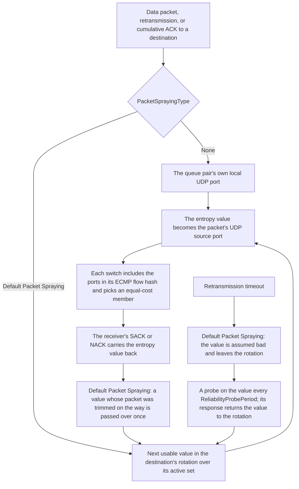

The Scala MRC NIC spreads its packets to a destination across equal-cost paths by varying each packet's entropy value, and stops using a path that fails.

This page covers what the entropy value is, how the switches use it to choose a path, the two spraying types `PacketSprayingType` selects, the active set of ports Default Packet Spraying rotates over, the path feedback and probes that take a failed path out of use and bring it back, and how spraying shares its state among the queue pairs to one destination. How a packet is built, acknowledged, and retransmitted is on [Transport](./transport.md); the attributes are in [ScalaMrcQpManager](./configuration.md#scalamrcqpmanager) and [DefaultPacketSpraying](./configuration.md#defaultpacketspraying) on [Configuration](./configuration.md).

## Overview

A destination reached through a fabric usually has several equal-cost paths, and each switch chooses among them per flow, by hashing the packet's headers ([ECMP path selection](../scala-switch/packet-handling.md#ecmp-path-selection)). The Scala MRC NIC varies one field that hash includes, the UDP source port of each packet, which carries the packet's entropy value. Packets of one message with different entropy values are different flows to the switches, so they can take different paths.

Packets that take different paths can arrive out of order. The receiver writes each one to host memory as it arrives and reports it in its SACKs, so spraying needs no reordering at the receiver ([Receiving a packet](./transport.md#receiving-a-packet)). The sender reads a gap in the SACKs as a loss only when it is more than `SACKLossMinRetxPkts` PSNs deep, which leaves room for paths of different delay ([Loss detection from SACK gaps](./transport.md#loss-detection-from-sack-gaps)).



## Entropy and the switch's path choice

The NIC writes each data packet's entropy value as its UDP source port; the destination port is always 4791. Under `Default Packet Spraying`, every data packet and every retransmission takes its value from the spraying state of its destination, and a retransmission takes a value anew, as a new packet does, so it can take a different path from the packet it replaces; under `None`, every packet takes its queue pair's own port ([None](#none)). The receiving NIC's cumulative ACKs take a value the same way, from its own spraying state for that peer or from its own queue pair's port. SACKs and NACKs carry back the entropy value of the packet that drew them, as their UDP source port and in their header, and the sender reads it as path feedback ([Path feedback and probes](#path-feedback-and-probes)). A probe is sent on the value it tests.

Whether a new entropy value means a new path depends on the switch's `EcmpHashMethod` ([Flow identity](../scala-switch/packet-handling.md#flow-identity)):

| `EcmpHashMethod` | Does the entropy value change the path? |
| --- | --- |
| `crc32WithSalt` (default), `crc32`, `hashWithSalt`, `hash` | Yes. The flow hash includes the UDP source and destination ports, so each entropy value is a flow of its own. |
| `dpr` | No. The member depends only on the destination address, so every packet to one destination takes the same member whatever the entropy value. |
| `dprWithFallback` | Only when the switch falls back to its CRC hash of the packet's headers. |

With the default `crc32WithSalt`, the entropy values a destination's packets carry spread them across the members of each equal-cost set they meet. Spraying changes nothing where a destination has only one path.

A configuration that places a Scala MRC NIC on `Default Packet Spraying`, its default, and a Scala Switch whose `LoadBalancingMethod` is `flowlet` draws a warning when the platform checks it; the simulation still runs. Packet spraying and flowlet switching both choose paths: the NIC through the entropy values it sends and the paths it takes out of use, the switch by moving flows between members at gaps ([Dynamic load balancing (flowlet)](../scala-switch/packet-handling.md#dynamic-load-balancing-flowlet)). With `PacketSprayingType` `None`, the combination draws no warning.

## Spraying types

`PacketSprayingType`, in `ScalaMrcQpManager`, selects how the entropy value is chosen:

| `PacketSprayingType` | Entropy value for each packet | Uses feedback | Attributes it reads |
| --- | --- | --- | --- |
| `None` | The local UDP port of the packet's queue pair | No | None |
| `Default Packet Spraying` (default) | The next usable value of a rotation over the destination's active set, a random subset of the 2^`EntropyMaskBits` ports that start at `StartingPortOffset` | Yes: trims and timeouts, with probes to bring a failed path back | `EntropyMaskBits`, `StartingPortOffset`, `ActiveEVSetSize`, `ReliabilityProbePeriod` |

Under `None`, the `DefaultPacketSpraying` attributes and `ReliabilityProbePeriod` are not used.

## None

With `None`, the NIC keeps no spraying state. Every packet of a queue pair, retransmissions included, uses that queue pair's own local UDP port, which the application sets, so it takes the same path through each switch; the receiving NIC's cumulative ACKs use its own queue pair's local port. Feedback is ignored, and no probes are sent.

The port belongs to the queue pair, not to the destination. The Chakra workload opens a queue pair for each message, with a port it sets for that message, so each message keeps to one path while different messages to one destination can take different paths, whatever `QPGroupsEnabled` is.

## Default packet spraying

With `Default Packet Spraying`, each destination has a rotation of entropy values, which every packet and retransmission to that destination steps through. The values come from a range of ports:

```text
range = StartingPortOffset to StartingPortOffset + 2^EntropyMaskBits − 1
```

- **`EntropyMaskBits`** sets the size of the range, 2^`EntropyMaskBits` values, from 0 to 8. At the default of 7 there are 128 values; at 8, 256. At 0 there is one value, `StartingPortOffset`, for every packet: a single path, on a port you choose.
- **`StartingPortOffset`** is the first port of the range, 0 to 65,535. At the defaults the range is ports 256 to 383. The range must fit below port 65,536: `StartingPortOffset` + 2^`EntropyMaskBits` − 1 must not exceed 65,535, so the largest offset is 65,408 at 7 bits and 65,280 at 8. Otherwise the simulation stops when the first queue pair is set up ([Configuration rules that stop a simulation](./configuration.md#configuration-rules-that-stop-a-simulation)).

The rotation belongs to the destination, so the packets of several messages in flight to one destination continue one sequence between them.

### The active set

The rotation does not use the whole range. When a destination's spraying state is created, with the first queue pair to it, the NIC draws a random subset of the range, the active set, in a random order and from a random starting point. Every packet takes the next usable value of the active set:

```text
active set size = ActiveEVSetSize                                      when ActiveEVSetSize > 0
                = min(packets in one bandwidth-delay product, 100)     when ActiveEVSetSize = 0, the default
                  then at least 1 and at most 2^EntropyMaskBits

packets in one bandwidth-delay product = link rate × ConfigBaseRTT ÷ 8 ÷ (MSS + 60), rounded down
```

The bandwidth-delay product comes from the link rate and `ConfigBaseRTT` when the destination's state is created; it does not follow the congestion window. At the defaults the active set is 72 of the 128 ports ([Worked example: the defaults](#worked-example-the-defaults)).

- **`ActiveEVSetSize` `0`**, the default, sizes the set to one bandwidth-delay product of packets, at most 100. When a full packet of `MSS` + 60 bytes is larger than the bandwidth-delay product, as with a very large `MSS` or a very small `ConfigBaseRTT`, the set has one value and nothing is sprayed.
- **A non-zero `ActiveEVSetSize`** sets the size directly, without the cap of 100; a value above 2^`EntropyMaskBits` gives the whole range. At `1`, each destination uses one randomly chosen port.

**Which value a packet takes.** A packet takes the next value of the rotation if that value is usable:

- A value that feedback has marked to be passed over is passed over: the NIC clears its mark and takes the next unmarked value among the 7 that follow it, using the cleared value if all of them are marked. Only the first marked value a packet meets has its mark cleared.
- A value assumed bad after a timeout is out of the rotation until a probe on it is answered ([Path feedback and probes](#path-feedback-and-probes)).
- If every value of the active set is assumed bad, the rotation uses them all anyway, so sending never stops.

## Path feedback and probes

Under Default Packet Spraying, the NIC keeps a state for each value of a destination's active set. Each SACK and NACK carries an entropy value back, and each retransmission timeout names the value of the transmission that timed out:

| Signal | What happens to the entropy value |
| --- | --- |
| SACK | Nothing changes |
| NACK for a packet trimmed on the way | Marked to be passed over once, even when the packet has already been acknowledged |
| NACK for a packet trimmed on the last hop | Nothing changes |
| NACK for a PSN out of range | Nothing changes |
| A loss found from a SACK gap | Nothing changes |
| Retransmission timeout | Assumed bad: the value leaves the rotation, and probing starts |
| Response to a probe | Usable again: the value returns to the rotation |

**Probes.** Every `ReliabilityProbePeriod`, 150 µs by default, the NIC sends one probe to each destination that has a value assumed bad and an open queue pair, to or from it, whose other end's QP number it knows. The probe goes out on one of that destination's values assumed bad, taking them in turn. Probing stops when no destination has a value assumed bad, and starts again at the next timeout.

- **The probe** is 74 bytes, carries a probe number and a timestamp, and uses no PSN. It is sent in the data class with the same codepoint role as a first transmission of data, so with `TrimmingEnabled` `true` a switch can trim it. When the egress pool has no room for it, it is not sent.
- **The response** is a SACK, 94 bytes, in the control class, carrying the probe number, the probed entropy value, and the timestamp plus the receiver's service time. The receiver's PSN state does not change. The response returns the value to the rotation and gives the sender an RTT sample of a round trip with no data packet in it, which can lower its base RTT ([Base RTT](./congestion-control.md#base-rtt)).

So with k values assumed bad at one destination, each is probed once every k × `ReliabilityProbePeriod`, and a value whose probe is lost stays out of the rotation until a later probe on it is answered. A timeout that queueing caused, with no failure on the path, takes the value out of use in the same way, until its probe is answered.

## Spraying and QP groups

The spraying state lives with the destination, whatever `QPGroupsEnabled` is: one active set, one rotation, one set of marks, and one set of values to probe for each remote address, shared by all the queue pairs to it. Feedback from any message to a destination shapes the values all of them are sent on.

- **`QPGroupsEnabled`** changes only the congestion window and the turns in the transmit scheduler, not the spraying state ([QP groups and the transmit scheduler](./transport.md#qp-groups-and-the-transmit-scheduler)).
- **A new state starts once no queue pair with the destination is open, in either direction.** The next queue pair to it draws a new random active set, with every value usable. With the Chakra workload, which closes each message's queue pair when the message is done, a message to a peer with which the NIC has no other message in flight, in either direction, starts a new state.

## Worked example: the defaults

The defaults are `PacketSprayingType` `Default Packet Spraying`, `EntropyMaskBits` 7, `StartingPortOffset` 256, `ActiveEVSetSize` 0, and `ReliabilityProbePeriod` 150 µs, with a 400 Gbps link, `ConfigBaseRTT` 6 µs, and `MSS` 4096:

```text
range                       2^7                                = 128 values
UDP source ports            256 to 256 + 128 − 1               = 256 to 383
bandwidth-delay product     400 Gbps × 6 µs ÷ 8                = 300,000 B
nominal packet              4,096 B + 60 B                     = 4,156 B
packets in one BDP          300,000 B ÷ 4,156 B                = 72, rounded down
active set                  min(72, 100), at most 128          = 72 values
1 MiB message alone         256 packets over 72 values         = 40 values used 4 times, 32 used 3 times
largest StartingPortOffset  65,536 − 128                       = 65,408 at 7 bits
probes, 3 values bad        3 × 150 µs                         = each value probed every 450 µs
```

A 1 MiB message that is the only one in flight to its destination sends 256 packets, so with no retransmissions and no marks it steps through the 72 values of the active set about 3.6 times: 40 values carry 4 of its packets and 32 carry 3. With the default `crc32WithSalt` hash on the switches, each value is a flow of its own at each switch.

## Records

- **`mrc-monitor`.** With the MRC Monitor on, each row carries an entropy value in its `ev` column ([mrc-monitor](./records.md#mrc-monitor)): for a data packet sent (`direction` `tx`) or retransmitted (`rtx`), the value it was sent on; for a SACK or NACK sent, the value it carries back; for a cumulative ACK sent, the value drawn for it; for a probe, the value probed; and for a packet received, its UDP source port. It shows the rotation over the active set.
- **`mrc-transport-stats`.** `total_probe_pkts_tx` and `total_probe_pkts_rx` count the probes sent and received. `total_ooo_events` counts the data packets that arrived ahead of the next expected PSN at this NIC as a receiver, and `calc_mean_reorder_depth` and `calc_max_reorder_depth` how many PSNs a queue pair held out of order; both rise when sprayed packets take paths of different delay. `total_rtx_sack` counts the retransmissions SACK gaps caused ([mrc-transport-stats](./records.md#mrc-transport-stats)).
- **The switch's load balancing record.** `scala-switch-load-balancing-stats` gives the bytes and packets each member of each equal-cost set carried, which shows how evenly the entropy values spread across the paths ([What is recorded](../scala-switch/packet-handling.md#what-is-recorded)).
