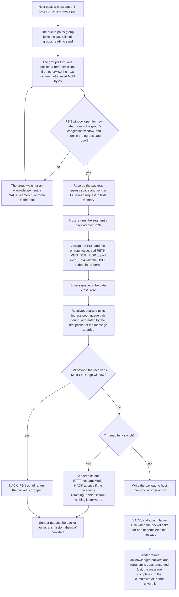

This page explains how the Scala MRC NIC carries a message from host memory to the wire and back, acknowledges it, and recovers lost packets.

It follows one message from the moment the host posts it to the moment the sender learns that every packet has arrived. How each packet's entropy value spreads a destination's packets across paths, and how probes bring a failed path back, is on [Multipath](./multipath.md); how the congestion window limits what is in flight is on [Congestion control](./congestion-control.md). The transmit and receive buffers the data passes through, traffic classes, and the PCIe link's rates and buffers have their own page, [Buffers and PCIe](./buffers-and-pcie.md). Attribute types and defaults are on [Configuration](./configuration.md), and the records are on [Records](./records.md).

## Data path at a glance



## Queue pairs and messages

All data moves over queue pairs (QPs). A QP connects two NICs. On the sending NIC, it has its own packet sequence numbers (PSNs) and its own record of the packets it has sent and not yet seen acknowledged; on the receiving NIC, its other side records the packets that have arrived. Each message is an RDMA Write, a one-way transfer of its bytes to the peer. The NIC sends no Write with Immediate, and there are no Send, Read, or Atomic operations.

The host posts a message by ringing the NIC's doorbell over PCIe with a work request (WQE) for the message's bytes. The [Chakra workload](../chakra-workload/index.md) opens a new QP for every message: the doorbell creates the sending side of the QP and queues the message on it in one step, and the workload closes both sides of the QP once the message has completed ([Completion](#completion)). On the receiving NIC, the first packet of the message to arrive, whichever one it is, creates the receiving side of the QP. Until the first SACK or NACK gives the sender the receiving side's QP number, every data packet carries what the receiving NIC needs to create it, and every retransmission carries it too.

With the doorbell, the QP's group joins the back of the NIC's list of groups that are ready to send ([QP groups and the transmit scheduler](#qp-groups-and-the-transmit-scheduler)), and the NIC starts its transmit process 15 ns later. Messages to different peers, and several messages to one peer, are in flight at the same time on their own QPs.

Each end names a QP by its own IPv4 address and its own QP number. [Identifying a NIC and a queue pair](./records.md#identifying-a-nic-and-a-queue-pair) shows how the records use those names.

## Segmentation

A message of N bytes is sent as `ceil(N ÷ MSS)` packets: each packet carries `min(MSS, bytes left)` bytes of payload, so every packet but the last of a message carries `MSS` bytes. A message of 0 bytes is sent as one packet with no payload, 78 bytes on the wire. Every packet of a message carries the same headers, and its opcode marks it as the first, a middle, the last, or the only packet of the message. A packet's size on the wire is its payload plus 78 bytes of headers ([Packets on the wire](#packets-on-the-wire)).

The NIC needs three things before it fetches a new segment's payload:

1. **An open PSN window.** The QP may have at most `MaxPSNRange` packets beyond its cumulative acknowledgement, counting packets whose payload is still being fetched. Only the cumulative PSN, which cumulative ACKs and SACKs both carry, moves this window forward: a packet retired by a SACK's bitmap still counts until every packet before it has been acknowledged too ([Cumulative acknowledgements](#cumulative-acknowledgements)). At the default 1,024 and the default `MSS` of 4096, the window is 4 MiB of payload. A QP whose PSN window is full waits, while the other QPs of its group go on.
2. **Room in the congestion window.** The window of the QP's group must be larger than the group's bytes in flight, counted at the nominal size of each packet, its IP datagram: the payload plus 60 bytes, or plus 64 with `RTTTimestampMode` `WireTimestamp`. A packet counts as in flight from the moment its fetch is issued ([The congestion window](./congestion-control.md#the-congestion-window)).
3. **Room in the egress pool.** The NIC reserves the packet's full size on the wire in the egress data pool ([Egress buffer](./buffers-and-pcie.md#egress-buffer)). The reservation lasts until the packet has been sent.

The congestion window usually binds before the PSN window does. The PSN window binds when a lost packet holds the cumulative acknowledgement back while SACKs for the packets after it keep freeing the congestion window.

If the congestion window is full, the group waits until an acknowledgement, a NACK, or a timeout frees room. If the egress pool is full, the NIC stops its transmit pass and keeps the group at the head of the list. It tries again on each cumulative ACK, SACK, NACK, and timeout, and 15 ns after the pool drains from above half its size to half or less.

## Fetching the payload over PCIe

The NIC and its host are joined by a PCIe link with a protocol stack at each end. For each segment:

1. **Reservation.** The egress space for the packet is reserved before the fetch ([Segmentation](#segmentation)).
2. **Read request.** The NIC sends one PCIe read request to host memory for the segment, a request of `ReadRequestSize` bytes, 64 by default, on the NIC-to-host direction of the link. `ReadRequestSize` sets the size of the request, not of the payload: the payload fetched is always the whole segment.
3. **Completion.** The host answers at once with the segment's payload. Host memory latency is not modeled: what the fetch costs is the time the request and the payload take on the link. Completions return in the order the requests were sent.
4. **Hand-off.** When the payload arrives, the packet takes the QP's next PSN and an entropy value from its destination's spraying ([Multipath](./multipath.md)), gets its headers, and goes to the egress queue of the data class ([Packets on the wire](#packets-on-the-wire)).

The NIC issues the fetches for every segment its gates allow in one pass; nothing else limits how many fetches are outstanding. A retransmission does not read the payload again: the NIC rebuilds the packet from its recorded size, so a retransmission costs no PCIe traffic.

At the default PCIe settings, the fetch of a full 4,096-byte segment takes about 70.8 ns on the link: 1.55 ns for the 64-byte read request from the NIC to the host and 69.29 ns for the completion from the host to the NIC, less than the 83.48 ns the packet takes on the 400 Gbps wire. [PCIe host interface](./buffers-and-pcie.md#pcie-host-interface) explains the lane rate, the lane count, and the transaction-layer buffers, with the rates they give.

Received data travels the other way: the payload of each received data packet, without its headers, is written to host memory as a PCIe write ([Receiving a packet](#receiving-a-packet)). The packet's receive-pool space is released when the write is accepted into the NIC's PCIe transmit buffer ([Receive buffer](./buffers-and-pcie.md#receive-buffer)).

## Packets on the wire

When a segment's payload arrives from the host, the NIC builds the data packet:

1. The **RDMA extended transport header (RETH)**, 16 bytes, carries the write's target and the message's total length, in every data packet.
2. With `RTTTimestampMode` `WireTimestamp`, a 4-byte **timestamp header** carries the time the packet was built, for the RTT measurement ([RTT measurement](#rtt-measurement)). With the default `LocalDatabase`, data packets carry none.
3. The **message extended transport header (METH)**, 4 bytes, carries the message sequence numbers.
4. The **base transport header (BTH)**, 12 bytes, carries the opcode, the receiving side's QP number, the PSN, the ACK-request flag ([Cumulative acknowledgements](#cumulative-acknowledgements)), and, on a retransmission, the retransmit flag.
5. The **UDP header**, 8 bytes, carries the packet's entropy value as its source port ([Multipath](./multipath.md)) and 4791, the RoCEv2 port, as its destination port. Every packet the NIC sends, data or control, goes to port 4791.
6. The **IPv4 header**, 20 bytes, carries the packet's DSCP codepoint ([Packet marking](#packet-marking)) and a TTL of 64.
7. The packet waits in the egress queue of its traffic class until the scheduler sends it ([Transmit scheduling](./buffers-and-pcie.md#transmit-scheduling)), and the network port adds a 14-byte Ethernet header and a 4-byte frame check sequence.

The port sends each frame at the link's rate, the lower of the NIC's `DataRate` and the rack switch's downlink rate. The interframe gap is zero, and a frame reaches the rack switch the NIC's `Delay` after its serialization ends. When serialization ends, the packet's egress reservation is released, and a data packet's retransmission timer starts ([Retransmission timer and retry budget](#retransmission-timer-and-retry-budget)).

| Packet | What it carries | Size on the wire |
| --- | --- | --- |
| Data | Payload of at most `MSS` bytes, RETH 16 B, METH 4 B, BTH 12 B, UDP 8 B, IPv4 20 B, Ethernet header and FCS 18 B | Payload + 78 B |
| Data, with `WireTimestamp` | As above, plus the 4-byte timestamp header | Payload + 82 B |
| Cumulative ACK | ACK extended transport header (AETH) 4 B, BTH 12 B, UDP 8 B, IPv4 20 B, Ethernet 18 B | 62 B |
| SACK, and the response to a probe | SACK header with congestion-control fields 36 B, BTH 12 B, UDP 8 B, IPv4 20 B, Ethernet 18 B | 94 B |
| NACK | NACK header 20 B, BTH 12 B, UDP 8 B, IPv4 20 B, Ethernet 18 B | 78 B |
| Probe | Probe header 16 B, BTH 12 B, UDP 8 B, IPv4 20 B, Ethernet 18 B | 74 B |
| Trimmed data packet, as the receiver gets it | IPv4, UDP, BTH, and METH headers 44 B, Ethernet 18 B | 62 B |

The preamble and interframe gap a physical link spends on each frame are not modeled.

### Worked example: packet sizes at the default MSS

At the default `MSS` of 4096, the default `RTTTimestampMode` `LocalDatabase`, and the default 400 Gbps `DataRate`:

```text
data packet        4,096 + 16 + 4 + 12 + 8 + 20 + 18      = 4,174 B   on the wire
                   4,174 B × 8 ÷ 400 Gbps                 = 83.48 ns
nominal packet     4,174 B − 18 B                         = 4,156 B   the IP datagram
peak goodput       400 Gbps × 4,096 ÷ 4,174               = 392.5 Gbps
WireTimestamp      4,174 B + 4 B                          = 4,178 B   on the wire
cumulative ACK     4 + 12 + 8 + 20 + 18                   =    62 B
SACK               36 + 12 + 8 + 20 + 18                  =    94 B
NACK               20 + 12 + 8 + 20 + 18                  =    78 B
probe              16 + 12 + 8 + 20 + 18                  =    74 B
trimmed packet     44 + 18                                =    62 B

1 MiB message      1,048,576 B ÷ 4,096 B                  =   256 packets
                   256 × 4,174 B                          = 1,068,544 B on the wire
                   1,068,544 B × 8 ÷ 400 Gbps             = 21.37 µs
SACKs              one for each data packet: 256 × 94 B   = 24,064 B
```

The nominal packet, 4,156 bytes, is the unit of the congestion window ([The congestion window](./congestion-control.md#the-congestion-window)). The egress reservation, and the charge to the receiver's ingress pool, is the full 4,174 bytes. With `WireTimestamp`, a data packet's size on the wire and its nominal size both grow by 4 bytes, to 4,178 and 4,160 bytes for a full packet, and bytes in flight count the larger size; the unit of the window's floor and of `MaxCongestionWindow` stays `MSS` + 60 bytes.

## Packet marking

Each packet's DSCP field carries a codepoint that names its role. The NIC chooses the codepoint from the kind of packet and two attributes of `ScalaMrcQpManager`:

| Packet | Codepoint role |
| --- | --- |
| Data, first transmission | Trimmable with `TrimmingEnabled` `true`, the default; no-trim with `TrimmingEnabled` `false`. The sending NIC fixes it for each QP when the QP is created. |
| Data, retransmission, after a timeout, a SACK gap, or a NACK | Trimmable retransmission with `UseDistinctDSCPForRetransmit` `true`, the default, whatever `TrimmingEnabled` is; otherwise the same role as a first transmission |
| Data, the duplicate of a message's last packet sent to draw a cumulative ACK ([Completion](#completion)) | The same role as a first transmission |
| Probe | The same role as a first transmission of data |
| Cumulative ACK, SACK, the response to a probe, and NACK | Control |

Two more roles are written by switches: trimmed, and trimmed on the last hop, which a switch writes when it trims a packet on a port that faces a NIC ([NACKs](#nacks)).

The codepoint also selects the NIC's own traffic class, in its egress buffer when it sends and in its ingress buffer when it receives: control, trimmed, and trimmed on the last hop use the control class, and every other codepoint uses the data class. The control class is sent ahead of waiting data, so acknowledgements and NACKs do not wait behind data, while probes and retransmissions wait with it ([Traffic classes](./buffers-and-pcie.md#traffic-classes)).

How a switch treats each role depends on its configuration:

- **Under the UET policy.** With `UETPolicyEnabled` `true`, the Scala Switch takes a packet's traffic class from its codepoint: control packets are TC2, trimmed packets TC1, and every other packet TC0. A packet with the trimmable-retransmission codepoint may use 1.5 times the egress queue limit ([Buffer under the UET policy](../scala-switch/shared-buffer.md#buffer-under-the-uet-policy)). The Scala MRC NIC sends these codepoints, so a switch with `UETPolicyEnabled` `true` accepts it ([Configuration rules that stop a simulation](../scala-switch/configuration.md#configuration-rules-that-stop-a-simulation)).
- **With packet trimming on.** A packet that would be dropped at egress is trimmed instead when its codepoint is trimmable or trimmable retransmission: the switch cuts it down to its headers, re-marks it as trimmed, and offers it again to the port's TC1 queue. A no-trim packet is dropped ([Egress admission](../scala-switch/packet-handling.md#egress-admission)). Switch trimming runs only under the UET policy and with PFC off on every switch traffic class ([Packet trimmer](../scala-switch/configuration.md#packet-trimmer)).
- **Without the UET policy.** The switch takes the traffic class from the DSCP value divided by 8, as for any other traffic ([Classification](../scala-switch/packet-handling.md#classification)).

`TrimmingEnabled` on the NIC marks packets; the switches trim them. With the NIC's defaults, a switch with trimming on trims both a first transmission and a retransmission that it cannot queue. With trimming off on the switches, trimmable packets are dropped like any other, and the sender recovers them from SACK gaps or with the retransmission timer.

## Receiving a packet

A received data packet takes this path:

1. **Receive pool.** The packet is charged to the ingress pool of its traffic class at its full size on the wire, 4,174 bytes for a full packet, or dropped if the pool cannot hold it ([Receive buffer](./buffers-and-pcie.md#receive-buffer)).
2. **QP.** The NIC finds the packet's QP from the QP number in its BTH. Packets sent before the sender has learned the receiving side's QP number carry none: the first of them to arrive creates the NIC's side of the QP, and the NIC matches the others to it ([Queue pairs and messages](#queue-pairs-and-messages)).
3. **PSN window.** A packet whose PSN is more than the receiving NIC's own `MaxPSNRange` beyond its cumulative acknowledgement is dropped, and the NIC sends a NACK for it ([NACKs](#nacks)).
4. **Trimmed packet.** When the sending NIC has the default `RTTTimestampMode`, `LocalDatabase`, a packet that a switch has trimmed delivers nothing, and draws a NACK when the receiving NIC's `TrimmingEnabled` is `true` ([NACKs](#nacks)).
5. **Delivery.** The NIC writes the packet's payload to host memory over PCIe as soon as it arrives, whether it is in order or not. There is no reorder buffer and nothing waits for a gap to fill.
6. **Acknowledgement.** The NIC sends a SACK when one of its triggers fires, and a cumulative ACK when the packet asks for one or completes the message ([Cumulative acknowledgements](#cumulative-acknowledgements), [Selective acknowledgements](#selective-acknowledgements)).

The QP tracks order as packets arrive. A packet with the next expected PSN advances it, past any packets already received beyond it. A packet with a higher PSN is out of order: the QP holds it for its SACKs and counts an out-of-order event. A packet the QP has already received, below the next expected PSN or held out of order, is counted as a duplicate. Duplicates do not add to the received bytes the receiver reports to the sender.

When the last packet of the message has arrived and no gap remains before it, the NIC tells the host that the message has arrived ([Completion](#completion)).

## Cumulative acknowledgements

A cumulative ACK, 62 bytes, carries the highest PSN the receiver has received in order. The receiver sends one at once when a data packet arrives with the ACK-request flag set, even a duplicate, and when an arrival moves the in-order PSN past the last packet of a message. Cumulative ACKs and SACKs leave in the control class, ahead of waiting data, and neither waits for the receiver's PCIe link: the receiver acknowledges a packet when it arrives, before its payload reaches host memory.

The sender sets the ACK-request flag on:

- **The last packet of each message.**
- **Every retransmission.**
- **A packet sent while the window is nearly full.** When the payload of a data packet arrives from the host and its group's congestion window has less than one nominal packet of room, or the window is smaller than 4,095 bytes, the packet carries the flag.

So a message whose packets arrive in order, are never retransmitted, and are never sent while the window is nearly full draws one cumulative ACK, for its last packet. A last packet that arrives ahead of a gap draws a second one when the gap closes, and each retransmission and each packet sent while the window is nearly full draws one more, as well as its SACK. The cumulative ACK's UDP source port carries an entropy value from the receiving NIC's own spraying for that peer ([Entropy and the switch's path choice](./multipath.md#entropy-and-the-switchs-path-choice)).

On the sender, a cumulative ACK, and the cumulative PSN every SACK also carries, retires every outstanding packet at or below that PSN. A retired packet's bytes no longer count as in flight, and only the cumulative PSN moves the QP's PSN window forward. A cumulative ACK gives no RTT sample and does not run the congestion window's routines; those run on SACKs ([How the window responds to each SACK](./congestion-control.md#how-the-window-responds-to-each-sack)). Only a cumulative ACK completes a message ([Completion](#completion)).

## Selective acknowledgements

The receiver sends a SACK, 94 bytes, at once when a data packet that is in its window and not trimmed fires any of these triggers:

- **Coalescing.** The receiver counts each data packet as its payload or 1,024 bytes, whichever is larger, and sends a SACK when the count since its last SACK passes 4,095 bytes. At the default `MSS` of 4096, every data packet draws a SACK.
- **The packet carries the ACK-request flag.**
- **The packet carries the retransmit flag.**
- **A gap has closed** after a packet that carried the ACK-request flag arrived while the gap was open.
- **The packet completes the message** in order.

| `MSS` | Data packets for each SACK from coalescing |
| --- | --- |
| 4,096 or more (default) | 1: every data packet draws a SACK |
| 2,048 to 4,095 | 2 |
| 1,366 to 2,047 | 3 |
| 1 to 1,365 | 4 |

**What a SACK carries:**

| Field | What it holds |
| --- | --- |
| Cumulative PSN | The highest PSN the receiver has received in order |
| Acknowledged PSN | The PSN of the packet that drew the SACK, as an offset from the cumulative PSN |
| Bitmap | PSNs the receiver holds beyond the cumulative PSN, in a block of 64 PSNs |
| Entropy value | The entropy value of the packet that drew the SACK, reflected back; it is also the SACK's UDP source port |
| QP numbers | The sending and receiving sides' QP numbers |
| Probe-response flag | Set on the response to a probe ([Path feedback and probes](./multipath.md#path-feedback-and-probes)) |
| Timestamp | The receiver's service time, or with `WireTimestamp` the reflected timestamp plus the service time ([RTT measurement](#rtt-measurement)) |
| Out-of-order count | How many PSNs the receiver holds out of order, at most 32,767 |
| Received bytes | How much data the receiver has received on the QP, first arrivals only, counted in 256-byte units; congestion control uses it |

When the receiver holds more out-of-order PSNs than one bitmap covers, successive SACKs report successive blocks of 64 PSNs, so together they cover every PSN it holds. The sender retires each PSN the bitmap lists, so its bytes no longer count as in flight, and a packet that arrives after a gap is acknowledged without waiting for the gap to fill. The SACK also gives the sender an RTT sample ([RTT measurement](#rtt-measurement)), feeds congestion control with the received bytes ([How the window responds to each SACK](./congestion-control.md#how-the-window-responds-to-each-sack)), and returns its entropy value as path feedback ([Path feedback and probes](./multipath.md#path-feedback-and-probes)).

### Loss detection from SACK gaps

SACKs also find lost packets. On each SACK, the sender looks at the highest PSN the SACK's bitmap lists. Every packet still outstanding more than `SACKLossMinRetxPkts` PSNs below it is presumed lost:

1. The packet is queued for retransmission ahead of new data. SACK gaps queue a given packet for retransmission at most once.
2. Congestion control reacts to the loss ([Loss reactions](./congestion-control.md#loss-reactions)). The path state of the packet's entropy value does not change.
3. The QP enters loss recovery: it looks for no further SACK gaps until its cumulative PSN reaches the highest PSN it had sent when recovery began.

`SACKLossMinRetxPkts` is a reorder allowance. Sprayed packets that take paths of different delay arrive out of order, and a gap within `SACKLossMinRetxPkts` PSNs of the highest PSN a SACK lists is treated as reordering, not loss:

- **At the default 512,** a gap is presumed lost once a packet more than 512 PSNs beyond it has been selectively acknowledged. That needs at least 513 more packets after the lost one on the same QP, 2.1 MB of payload at the default `MSS`, so in a shorter message a lost packet is recovered by a trim NACK or by the retransmission timer instead.
- **At `0`,** any gap below the highest PSN in a SACK is presumed lost at once, so packets that spraying merely reordered are retransmitted too.
- **At `MaxPSNRange` − 1 or more,** SACK gaps never find a loss, because the PSN window keeps every outstanding packet within `MaxPSNRange` − 1 PSNs of the newest one. Losses are then recovered by trim NACKs and the retransmission timer.

At the defaults and line rate, the loss is found about 513 × 83.48 ns ≈ 42.8 µs of sending after the lost packet, plus a round trip, well before the lost packet's 150 µs timeout.

## NACKs

A switch with packet trimming on cuts a trimmable packet that it cannot queue down to its IPv4, UDP, BTH, and METH headers, 44 bytes and 62 on the wire, marks it as trimmed, and forwards it to the receiver. On the hop to a NIC, it marks it as trimmed on the last hop instead ([Egress admission](../scala-switch/packet-handling.md#egress-admission)).

In the NIC's default behavior, with the sending NIC's `RTTTimestampMode` at its default, `LocalDatabase`, the receiving NIC recognizes a trimmed packet by its codepoint. The packet's PSN stays a gap: the NIC delivers nothing to the host, records nothing for its SACKs, and sends no cumulative ACK or SACK for it, even if the packet carries the ACK-request flag. It counts the trim and releases the packet's receive-pool space. Then, only if the receiving NIC's own `TrimmingEnabled` is `true`, it sends a NACK at once, naming the packet's PSN. With `TrimmingEnabled` `false` on the receiver, no NACK is sent, and the sender recovers the packet from a SACK gap or with its retransmission timer.

The NIC sends three NACK codes:

| NACK code | Sent by the receiver when | What the sender does, for a packet still outstanding |
| --- | --- | --- |
| Trimmed | A data packet arrives trimmed on the way, and the receiver's `TrimmingEnabled` is `true` | Queues the packet for retransmission ahead of new data; congestion control reacts to the trim ([Loss reactions](./congestion-control.md#loss-reactions)); the entropy value the packet was sent on is passed over once ([Path feedback and probes](./multipath.md#path-feedback-and-probes)) |
| Trimmed on the last hop | A data packet arrives trimmed on the last hop, and the receiver's `TrimmingEnabled` is `true` | As for trimmed, except that the entropy value's path state does not change |
| PSN out of range | A data packet's PSN is more than the receiver's own `MaxPSNRange` beyond its cumulative PSN, whatever `TrimmingEnabled` is; the packet is dropped | Queues the packet for retransmission; its bytes no longer count as in flight, but the window is not cut and the path state does not change |

A NACK for a packet that has already been acknowledged changes nothing, except that a NACK for a packet trimmed on the way still marks its entropy value to be passed over once. A gap in the sequence draws no NACK. Between NICs with the same `MaxPSNRange`, a sender never sends that far ahead, so the PSN-out-of-range NACK appears only when the receiving NIC's `MaxPSNRange` is smaller than its sender's.

A NACK reflects the entropy value of the packet that drew it, as its UDP source port, and, like a SACK, can give the sender an RTT sample ([RTT measurement](#rtt-measurement)). After a NACK, the transmit process restarts at once.

**Retransmission ahead of new data.** Within a QP, a queued retransmission is always sent before new data, and a group that joins the transmit scheduler's list with a retransmission waiting joins at its head ([QP groups and the transmit scheduler](#qp-groups-and-the-transmit-scheduler)). A retransmission needs room in the congestion window and in the egress pool, as a new packet does, but not in the PSN window. Every retransmission, whatever caused it, takes its entropy value from its destination's spraying anew, so under Default Packet Spraying it can take a different path from the packet it replaces ([Multipath](./multipath.md)); it carries the retransmit and ACK-request flags, and is marked as a trimmable retransmission by default ([Packet marking](#packet-marking)).

## Retransmission timer and retry budget

The retransmission timer is per packet. It starts when the packet's serialization onto the link ends, and runs until the packet is acknowledged. When it expires while the packet is still outstanding:

1. The packet's bytes no longer count as in flight, and congestion control reacts to the loss ([Loss reactions](./congestion-control.md#loss-reactions)).
2. Under `Default Packet Spraying`, the entropy value the packet was sent on is assumed bad: it leaves its destination's rotation until a probe on it is answered ([Path feedback and probes](./multipath.md#path-feedback-and-probes)).
3. The packet is queued for retransmission ahead of new data, and the transmit process restarts at once.

A timer that expires after its packet has been acknowledged, or while the packet is already queued for retransmission, does nothing.

How long each timer runs is set by three attributes of `ScalaMrcQpManager`. Counting the timer that starts with the packet's first transmission as timer 1:

```text
timer k = InitialAckTimeout                                   for k ≤ LinearRetryCount
timer k = InitialAckTimeout × 2^(k − LinearRetryCount)        for k > LinearRetryCount
          doubling at most 24 times, and never longer than 2^34 ns ≈ 17.18 s
```

- **`InitialAckTimeout`** is the base timeout, from 1 ns to 8 s, 150 µs by default. The NIC checks its timers every microsecond, and each timeout is rounded down to whole microseconds, with a minimum of 1 µs.
- **`LinearRetryCount`**, from 0 to 7, is how many timers of a packet run at `InitialAckTimeout` before the doubling begins. At `0`, the first timeout is already 2 × `InitialAckTimeout`.
- **`FixedRexmitTimeEnable`** `true` makes every timer `InitialAckTimeout`, with no doubling.

Only timeouts advance a packet along this schedule. A retransmission that a NACK or a SACK gap caused starts the packet's schedule again at timer 1.

**The retry budget.** A packet may be retransmitted after a timeout at most `LinearRetryCount` + `ExponentialRetryCount` times; `ExponentialRetryCount` is from 0 to 25. If its timer expires again after that many, the packet is not retransmitted: its QP enters an error state. Retransmissions that NACKs cause are counted separately against a limit of the same size: a NACK that would retransmit a packet once more than that puts its QP in the error state instead. Retransmissions from SACK gaps are not counted, since a SACK gap queues a packet at most once. At `ExponentialRetryCount` 25, the default, there is no budget: the NIC retransmits a packet until it is acknowledged, whatever `LinearRetryCount` is.

A QP in the error state sends nothing more, new data or retransmissions, and its timers are ignored. Its message never completes. The `mrc-transport-stats` record counts the error in `total_qp_error`, the `mrc-events` record logs a `QP_ERROR` event when event logging is on, and the MRC Monitor's `qp_error` trigger can add the QP to the `mrc-monitor` record ([Records](./records.md)).

### Worked example: the retry schedule at the defaults

At the defaults, `InitialAckTimeout` 150 µs, `LinearRetryCount` 7, `ExponentialRetryCount` 25, and `FixedRexmitTimeEnable` `false`, a packet whose transmissions keep timing out sees:

```text
timers 1 to 7      150 µs each                                     LinearRetryCount 7
timer 8            150 µs × 2^1                                    = 300 µs
timers 9, 10, 11   150 µs × 2^2, 2^3, 2^4                          = 600 µs, 1.2 ms, 2.4 ms
timer 23           150 µs × 2^16                                   = 9.83 s
timer 24 onward    150 µs × 2^17 would be 19.66 s; capped at 2^34 ns ≈ 17.18 s
8th timeout        7 × 150 µs + 300 µs                             = 1,350 µs after the first send
retry budget       ExponentialRetryCount 25                        = none: the NIC never gives up
```

Each retransmission's own queueing and serialization add to these times. With `ExponentialRetryCount` set to `0` and the other defaults, the budget is 7: the packet is retransmitted after each of its first 7 timeouts, and at the 8th timeout, about 1,350 µs after the first send, its QP enters the error state instead.

## RTT measurement

The sender takes round-trip time (RTT) samples from SACKs, from NACKs, and from the responses to probes; a cumulative ACK gives none. Congestion control uses them for its base RTT and its queueing delay ([Base RTT](./congestion-control.md#base-rtt)). `RTTTimestampMode` selects how a sample is taken:

| | `LocalDatabase` (default) | `WireTimestamp` |
| --- | --- | --- |
| Data packet | No timestamp: payload + 78 B on the wire | A 4-byte timestamp of when its headers were built, retransmissions included: payload + 82 B |
| A SACK's sample | The SACK's arrival, less the time the packet that drew it finished serializing, less the service time the receiver reports | The SACK's arrival, less the reflected timestamp plus the service time the receiver reports |
| Which SACKs give a sample | A SACK whose packet is still outstanding and was sent once, or retransmitted once and the SACK was drawn by the retransmission | Every SACK |
| Resolution | Nanoseconds; the service time subtracted is in 128 ns steps | 128 ns |
| What the sample includes | The path from the end of serialization | Also the sender's own egress queueing and serialization |

**The service time** is the time, at the link rate, of the packet that drew the SACK plus the bytes waiting ahead of the SACK in the receiver's control-class egress queue, rounded down to a whole number of 128 ns steps. It does not include the receiver's PCIe link. At the defaults, with no control packets waiting, a full data packet takes 83.48 ns, so the service time reported is 0.

A NACK carries no service time, and its sample is taken with a service time of 0. A probe's response gives a sample of a round trip with no data packet in it ([Path feedback and probes](./multipath.md#path-feedback-and-probes)).

## QP groups and the transmit scheduler

With `QPGroupsEnabled` `true`, the default, every QP from this NIC to the same remote IPv4 address joins one QP group. The QPs of a group share one congestion window ([Congestion control](./congestion-control.md)), and they are scheduled as one group. Each QP keeps its own PSNs, outstanding packets, retransmissions, PSN window, and received packets. The receiving sides of QPs from that peer join the same group, but they send no data. The spraying state is kept per destination whatever `QPGroupsEnabled` is ([Spraying and QP groups](./multipath.md#spraying-and-qp-groups)).

A group lives while any of its QPs does. With the Chakra workload, which closes each message's QP when the message is done, a message to a peer with which the NIC has no other message in flight, in either direction, starts a new group: a new congestion window at its initial size ([The congestion window](./congestion-control.md#the-congestion-window)), and a base RTT back at `ConfigBaseRTT` ([Base RTT](./congestion-control.md#base-rtt)).

**The transmit scheduler.** The NIC keeps one list of groups that are ready to send. A group is ready when its congestion window has room and one of its QPs has a retransmission waiting, or new data with its PSN window open. The NIC serves the list in turns:

1. It takes the group at the head of the list.
2. It sends one packet from one QP of the group: a retransmission, with no PCIe fetch, if that QP has one waiting, otherwise the fetch of its next segment. The QPs of a group take turns, and the turn passes to the next QP with work once the current one has sent.
3. If the group still has work, it goes back on the list: at the head if it has a retransmission waiting, otherwise at the tail. Then the next group at the head takes its turn.
4. The NIC repeats this until no group is ready, all at one instant of simulated time.

A group that joins the list because an acknowledgement freed room in its window joins at the tail, and one that joins with a retransmission waiting joins at the head; a group already on the list keeps its place. Within a group, a QP with a retransmission waiting still waits for its turn among the group's QPs. When the egress pool is full, the scheduler stops with the group at the head and tries again as [Segmentation](#segmentation) describes.

| `QPGroupsEnabled` | Congestion window | Turns in the scheduler | Spraying state |
| --- | --- | --- | --- |
| `true` (default) | One window shared by all the messages in flight to a destination | One per destination | One per destination |
| `false` | One window per QP, so N messages in flight to one destination have N windows, each starting at the initial window | One per QP | Still one per destination, shared by its QPs |

With the Chakra workload, a QP is one message, so with `QPGroupsEnabled` `false` every message has its own window and its own turn, while the messages to one destination still share one spraying state.

## Completion

A message produces three completions, and the `mrc-events` record shows each one as an event ([mrc-events](./records.md#mrc-events)):

| Event | Where | When |
| --- | --- | --- |
| `SEND_COMPLETE` | Sender | The payload of the message's last segment has come back from the host over PCIe and been queued for the wire. The data has not yet been acknowledged. |
| `WQE_COMPLETE` | Sender | A cumulative ACK covers every PSN the message was sent with. SACKs alone never complete a message. The NIC reports it to the host, and the Chakra workload then closes the QP. |
| `RECV_COMPLETE` | Receiver | The last packet of the message has arrived, in any order, and no gap remains before it. |

The message's completion time, as the sender sees it, is therefore the arrival of the cumulative ACK that covers it, normally the one its last packet asked for, not the time of its last transmission.

**Completion re-request.** If SACKs have acknowledged every packet of a message but no cumulative ACK covering it has arrived, the sender asks again. From `SEND_COMPLETE` on, it checks every 2 × `InitialAckTimeout`, 300 µs at the default, and when it finds the message in that state, it sends the message's last packet again as a duplicate with the ACK-request and retransmit flags, which draws a cumulative ACK. The duplicate is not counted as a retransmission. So a lost final cumulative ACK delays the message's completion by at most 2 × `InitialAckTimeout` and a round trip.

## Records

With the defaults, `EnableTransportStats` `true`, a simulation writes one `mrc-transport-stats` row for each Scala MRC NIC every `TransportStatsReportInterval`, 1 ms by default. Each row combines every QP on the NIC. Each counter has two columns: `total_` followed by its name counts the whole simulation so far, and `ivl_total_` followed by its name counts the interval since the previous row. [mrc-transport-stats](./records.md#mrc-transport-stats) lists every column.

| Columns | What they show on this page |
| --- | --- |
| `total_write_pkts_tx`, `total_write_pkts_rx` | Data packets sent, retransmissions and completion re-requests included, and data packets received, trimmed packets and duplicates included |
| `total_ack_pkts_tx`, `total_ack_pkts_rx` | Cumulative ACKs sent and received |
| `total_sack_pkts_tx`, `total_sack_pkts_rx` | SACKs sent and received |
| `total_nack_pkts_tx`, `total_nack_pkts_rx` | NACKs sent and received |
| `total_nack_trimmed_rx`, `total_nack_trimmed_lasthop_rx`, `total_nack_psnoor_rx` | NACKs received, by code |
| `total_trim_pkts_rx`, `total_trim_lasthop_pkts_rx` | Trimmed data packets received, by codepoint, from senders with the default `RTTTimestampMode` |
| `total_rtx_pkts`, `total_rtx_rto`, `total_rtx_sack`, `total_rtx_nack` | Retransmissions sent, in all and by what caused them: a timeout, a SACK gap, or a NACK |
| `total_rto_events` | Retransmission timer expiries that queued a packet for retransmission |
| `total_ooo_events`, `total_dup_events` | Data packets received ahead of the next expected PSN, and duplicates received |
| `calc_mean_reorder_depth`, `calc_max_reorder_depth` | PSNs a QP held out of order, sampled at each data packet received |
| `calc_max_max_tx_count` | The most transmissions any one packet has needed |
| `total_qp_error` | QPs that entered the error state |
| `total_wqes_created`, `total_wqes_completed` | Messages posted to this NIC, and messages a cumulative ACK has completed |

With `EnableEventLogging` `true`, the `mrc-events` record adds one row for each QP and message event: a QP created, closed, or in error, a message posted, and the three completions ([mrc-events](./records.md#mrc-events)). With the MRC Monitor on, the `mrc-monitor` record has one row for each packet it logs, sent or received, with its `packet_type`, its PSN in `bth_psn`, its ACK-request flag in `ar_bit`, its codepoint role in `dscp`, and, for each data packet sent, its transmission count in `tx_count` and, for a retransmission, what caused it in `rtx_origin`; rows for SACKs received add the PSN that drew the SACK and the PSNs its bitmap lists, and rows for NACKs received add the code ([mrc-monitor](./records.md#mrc-monitor)).
