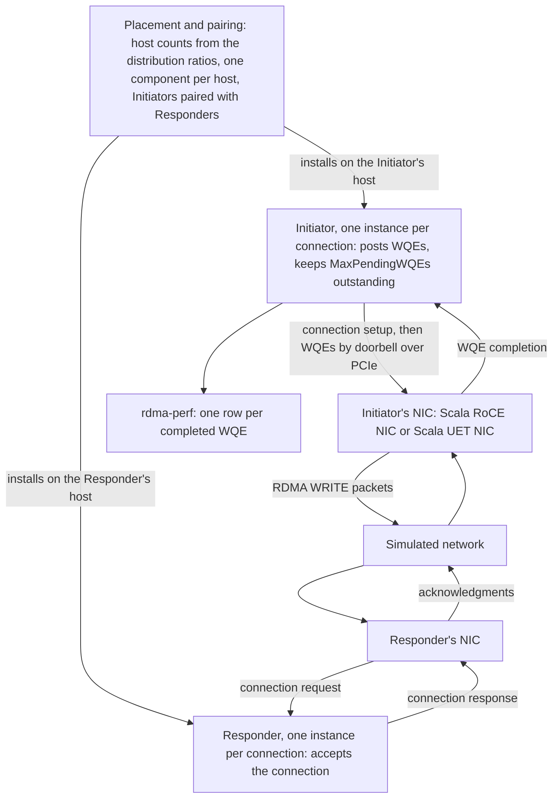

The Scala RDMA application generates RDMA WRITE traffic between pairs of hosts, keeping a set number of work requests outstanding on each connection.

Model version 3.5.0 is the version these pages describe.

## What this model simulates

The Scala RDMA application is an application model for simulations that do not replay Chakra traces. It has two components: the Initiator, which writes data, and the Responder, which accepts the Initiator's connections. Before the simulation starts, the platform assigns every host (a server node of the configuration's topology) one of the two components, in the proportions the distribution ratios set, and pairs each Initiator with a Responder on another host. Each pair has one or more connections. Each connection has its own instance of the Initiator and of the Responder, and is a queue pair on the two hosts' NICs.

On each connection, the Initiator posts work requests to its NIC, each an RDMA WRITE of 250,000 bytes. Work requests are called WQEs (work queue elements) on these pages. The Initiator keeps `MaxPendingWQEs` of them outstanding: it posts that many when data transfer starts and one more each time one completes. The NIC fetches each WQE's payload from host memory over PCIe, carries it to the Responder's NIC across the simulated network, and completes the WQE when the Responder's NIC has acknowledged all of it. The load the application offers is therefore closed-loop: it is set by how fast the NICs and the network complete WQEs, not by a rate.

The results you reason about with it are the time each WQE takes from the moment it is posted to its completion, and how many WQEs complete over the run, under the congestion, flow control, and NIC settings of the topology.

The Scala RDMA application runs on hosts that all have a Scala RoCE NIC or all have a Scala UET NIC. It cannot share a simulation with the [Scala Traffic Generator](../scala-traffic-generator/index.md), the Scala UDP Echo application, or the [Chakra workload](../chakra-workload/index.md).

Simulations on the platform carry IPv4 traffic.

## Features

- **RDMA WRITE work requests.** Each WQE is an RDMA WRITE of 250,000 bytes. The Initiator posts it to the NIC with a doorbell message over the host's PCIe link; the NIC fetches the payload over PCIe, sends it as packets, and completes the WQE when all of it is acknowledged. See [WQEs](./traffic-generation.md#wqes).
- **Closed-loop generation.** Each connection keeps `MaxPendingWQEs` WQEs outstanding from the start of data transfer to the end of the run, posting a new WQE as each one completes. See [Closed-loop generation](./traffic-generation.md#closed-loop-generation).
- **Several connections per pair.** `NumConnections`, from 1 to 1,024, sets the number of independent connections between an Initiator and each Responder it is paired with, each with its own queue pair and its own outstanding WQEs. See [Connections](./traffic-generation.md#connections).
- **Placement and pairing by ratio.** The distribution ratios set how many hosts run the Initiator and how many run the Responder; every host runs one of the two, never both, and pairing is random and repeatable for a given `RandomSeed`. See [Placement and pairing](./traffic-generation.md#placement-and-pairing).
- **Start types.** `StartType` spreads the connection setups across the client start window, the part of the run in which the Initiators, the application's clients, start: all at once, at independent random times, or evenly spaced. See [Start types](./traffic-generation.md#start-types).
- **Data traffic class, RFC 2474.** On the Scala RoCE NIC, `RdmaDataPacketTC` selects the traffic class of the WRITE data packets, which sets the NIC's transmit queue and the packets' DSCP codepoint. See [Traffic class on the Scala RoCE NIC](./traffic-generation.md#traffic-class-on-the-scala-roce-nic).
- **Statistics.** One `rdma-perf` row for each completed WQE, with the time from its doorbell to its completion, and running counts of WQEs posted and completed in the beacon record. See [Records](./traffic-generation.md#records).

## Architecture

The platform assigns and pairs the hosts before the simulation starts. In the simulation, each connection's Initiator posts WQEs to its host's NIC, and the NICs carry them across the network.

| Component | Responsibility | Configured by |
| --- | --- | --- |
| Placement and pairing | Runs before the simulation. Turns the distribution ratios into numbers of Initiator and Responder hosts, gives every host one of the two components, and pairs each Initiator with a Responder on another host. | [Distribution ratios](./configuration.md#distribution-ratios) |
| Initiator | One instance per connection. Sets up the connection with its Responder, posts WQEs to its NIC with a doorbell, keeps `MaxPendingWQEs` of them outstanding, and writes a `rdma-perf` row for each WQE that completes. | [Initiator](./configuration.md#initiator) |
| Responder | One instance per connection. Accepts the connection; the Responder's NIC acknowledges the data the Initiator writes. | [Responder](./configuration.md#responder) |

The NICs carry the traffic: [Scala RoCE NIC](../scala-roce-nic/index.md) and [Scala UET NIC](../scala-uet-nic/index.md) describe their transports.

## How to read these pages

Read them in this order:

1. [Traffic generation](./traffic-generation.md): how hosts are assigned and paired, the run's timeline, how connections are set up, how WQEs are posted and completed, how a run ends, and the records a run writes, with worked examples of placement, timing, and one WQE.
2. [Configuration](./configuration.md): every attribute that changes a run, with its type and default, how to add the application and change its values through the platform API, and the rules that stop a simulation.
