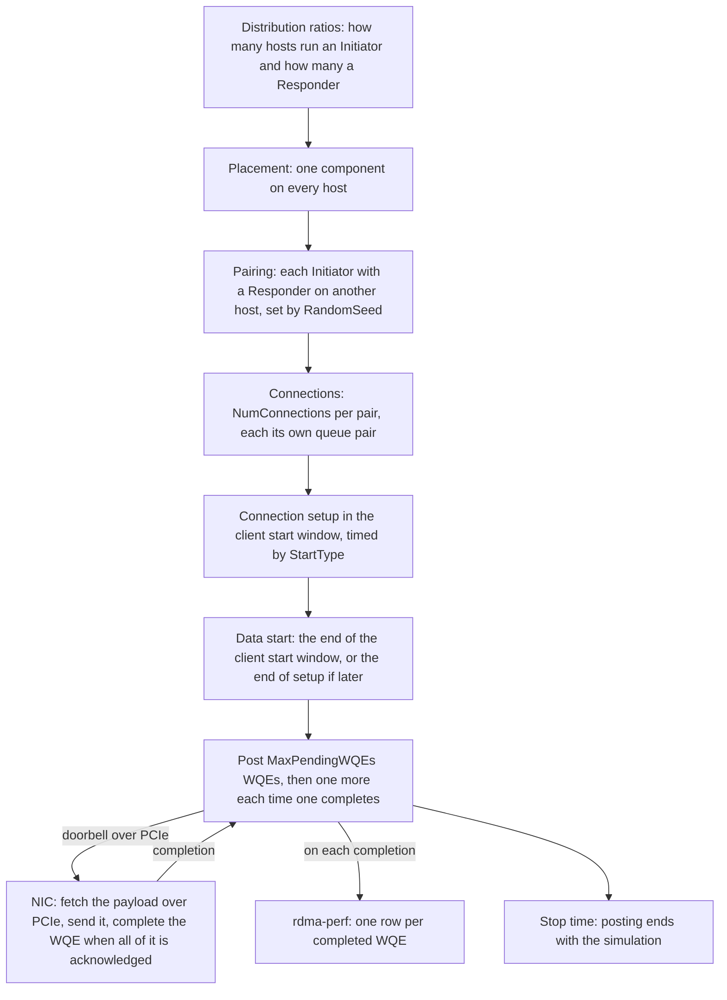

This page follows the Scala RDMA application through a run: where it runs, how connections are set up, how work requests flow, and what it records.

Before the simulation starts, the platform places the Initiators and Responders on the hosts and pairs them. In the simulation, each connection's setup starts in the client start window, and from the end of that window, or from the end of the connection's setup if that is later, each connection keeps `MaxPendingWQEs` RDMA WRITE work requests (WQEs) outstanding until the run stops. [Configuration](./configuration.md) lists the attributes this page refers to, and [the overview](./index.md) summarizes the model.

## Overview



## Placement and pairing

Before the simulation starts, the platform decides how many hosts run the Initiator and how many run the Responder, assigns the hosts, and pairs them. A host is a server node of the configuration's topology.

### Host counts

Each component has a distribution ratio: `prScalaRdmaInitiator` for the Initiator and `prScalaRdmaResponder` for the Responder ([Distribution ratios](./configuration.md#distribution-ratios)). The number of hosts that run each is:

```text
hosts running a component = floor(ratio x hosts), and at least 1 for a ratio above 0
```

If these counts add up to fewer than the hosts, each component whose share is still below its ratio gets one more host, in turn and starting with the Initiator, until every host runs one component. A host therefore runs the Initiator or the Responder, never both.

The ratios of all the applications in a configuration share one budget, and they must add up to 1. A ratio of 0 makes the configuration invalid. When you add an application, the platform splits 1.0 evenly over every client and server entry of every application in the configuration, so the Scala RDMA application on its own gets 0.5 for the Initiator and 0.5 for the Responder.

### Pairing

Each Initiator is paired with a Responder on another host:

1. Each Initiator in turn takes a Responder that no other Initiator has yet, picked at random.
2. Once every Responder has an Initiator, each further Initiator picks any Responder at random, so a Responder can serve several Initiators.
3. If Responders are left over because there are more Responders than Initiators, each of them gets an Initiator picked at random, so an Initiator can have several Responders.

Pairing is random and set by the global simulation parameter `RandomSeed` (default `18760`): the same configuration with the same seed gives the same pairs. Each pair has its own connections ([Connections](#connections)).

### Worked example: 16 hosts

```text
Ratios 0.5 and 0.5 (the application on its own, as added), 16 hosts
  Initiators  floor(0.5 x 16) = 8
  Responders  floor(0.5 x 16) = 8                    8 + 8 = 16 hosts, no top-up
  pairing     each Initiator takes a different Responder: 8 pairs

Ratios 0.9 and 0.1, 16 hosts
  Initiators  floor(0.9 x 16) = floor(14.4) = 14
  Responders  floor(0.1 x 16) = floor(1.6)  = 1      14 + 1 = 15 hosts
  top-up      Initiators hold 14 / 16 = 0.875, below 0.9: Initiators = 15
              (Responders, at 1 / 16 = 0.0625, are below 0.1 too, but the
              Initiator comes first and takes the last host)
                                                     15 + 1 = 16 hosts
  pairing     all 15 Initiators pair with the one Responder: 15 pairs

Ratios 0.25 and 0.75, 16 hosts
  Initiators  floor(0.25 x 16) = 4
  Responders  floor(0.75 x 16) = 12                  4 + 12 = 16 hosts, no top-up
  pairing     each Initiator takes a different Responder: 4 pairs
              each of the other 8 Responders gets an Initiator picked at random:
              8 more pairs, 12 in all, and each Initiator has 3 Responders on average
```

## Connections

The Initiator's `NumConnections` (default `1`, from 1 to 1,024) sets the number of connections each pair has. Each of the N connections has its own Initiator instance on the Initiator's host, its own Responder instance on the Responder's host, and its own queue pair on each of the two NICs. The connections are independent: each is set up at its own start time and keeps its own `MaxPendingWQEs` WQEs outstanding ([Closed-loop generation](#closed-loop-generation)). An Initiator paired with several Responders has `NumConnections` connections to each.

## Run timeline

Six global simulation parameters set the run's timeline. They are not attributes of this model: they sit in the configuration's `SimulationParameters` and are changed with `PATCH /api/v1/configurations/{config_id}/parameters` ([Change the global simulation parameters](./configuration.md#change-the-global-simulation-parameters)). Times are in seconds of simulation time.

```text
Responders start      at StartTime
client start window   from StartTime + ClientStartOffset, lasting ClientStartInterval
recording window      from the end of the client start window + WarmUp, lasting RunTime
stop time             the end of the recording window + CoolDown
```

The Responders start listening at `StartTime`. The Initiators are the application's clients, so each connection is set up at a time in the client start window that `StartType` sets ([Start types](#start-types)). WQE posting starts at the end of the client start window, or when the connection's setup completes if that is later ([Connection setup](#connection-setup)), and continues until the stop time ([How a run ends](#how-a-run-ends)).

### Start types

The Initiator's `StartType` sets when each connection starts, that is, when its Initiator sends the connection request:

| `StartType` | When each connection starts |
| --- | --- |
| `simultaneous` (default) | Every connection at the start of the client start window. |
| `uniform` | Each connection at its own random time in the window, drawn independently and uniformly. |
| `sequential` | One connection after another, evenly spaced across the window, the first at its start. When the simulation runs as several simulator processes, each process spaces its own connections across the window. |

`StartType` times the connection setups only. Whatever its value, no WQE is posted before the end of the client start window.

### Worked example: the default timeline

The defaults are `StartTime` 0.001, `ClientStartOffset` 0.001, `ClientStartInterval` 0.001, `WarmUp` 0.002, `RunTime` 0.5, and `CoolDown` 0.001.

```text
Responders start      0.001 s
client start window   0.001 + 0.001 = 0.002 s   to   0.002 + 0.001 = 0.003 s
recording window      0.003 + 0.002 = 0.005 s   to   0.005 + 0.5   = 0.505 s
stop time             0.505 + 0.001 = 0.506 s
```

With the default `StartType`, `simultaneous`, every connection sends its connection request at 0.002 s, and every connection posts its first WQEs at 0.003 s. WQEs are posted from 0.003 s to 0.506 s.

## Connection setup

Each connection is set up with three messages between the two hosts, carried across the simulated network:

1. The Initiator sends a connection request to its Responder.
2. The Responder's side answers with a connection response, and its NIC creates the Responder's end of the queue pair.
3. When the response arrives, the Initiator's NIC creates the Initiator's end of the queue pair, and the Initiator sends an acknowledgment.

The connection is then set up, and it lasts until the stop time. Its WQEs start at the end of the client start window, or at once if the setup completes after that.

## WQEs

Every WQE is an RDMA WRITE of 250,000 bytes from the Initiator's host to the Responder's host. Each WQE goes through these steps:

1. **Doorbell.** The Initiator posts the WQE to its NIC with a doorbell message over the host's PCIe link. The message carries `DoorbellPayloadSize` bytes (default `64B`) plus 28 bytes of UDP and IPv4 headers. The doorbell stays on the PCIe link: it adds bytes and transfer time on the host-to-NIC direction of that link for every WQE, and it never reaches the network.
2. **Queueing at the NIC.** The NIC sends one WQE of a connection at a time. The connection's other outstanding WQEs wait at the NIC, in the order they were posted, until the WQE ahead of them completes.
3. **Transmission.** The NIC fetches the WQE's payload from host memory over PCIe, cuts it into packets of at most the NIC's maximum segment size, and sends them to the Responder's NIC across the simulated network. The NIC chooses each packet's opcode.
4. **Completion.** The Responder's NIC acknowledges the data. When all of the WQE is acknowledged, the Initiator's NIC completes the WQE and reports the completion to the Initiator.

`OpCode` and `RdmaVerb` each have one allowed value, `RDMA_OPCODE_WRITE_FIRST` and `RDMA_VERB_POST_WRITE`: every WQE is an RDMA WRITE.

### Worked example: one WQE on the Scala RoCE NIC

The Scala RoCE NIC's default maximum segment size is 4,096 bytes, it adds 58 bytes of headers to each packet, and its port runs at 400 Gbps by default ([Segmentation](../scala-roce-nic/transport.md#segmentation), [Packets on the wire](../scala-roce-nic/transport.md#packets-on-the-wire)).

```text
doorbell            64 + 28 = 92 bytes over PCIe
packets             ceil(250,000 / 4,096) = ceil(61.04) = 62
                    61 full packets: 61 x 4,096 = 249,856 bytes
                    last packet: 250,000 - 249,856 = 144 bytes
opcodes             1 WRITE FIRST, 60 WRITE MIDDLE, 1 WRITE LAST
bytes on the wire   250,000 + 62 x 58 = 253,596 bytes
serialization       253,596 x 8 / 400 Gbps = 5.07 us
```

## Closed-loop generation

When data transfer starts, each connection posts `MaxPendingWQEs` WQEs at once. After that, it posts one new WQE each time one of its WQEs completes, so it keeps exactly `MaxPendingWQEs` WQEs outstanding until the run stops (none, at `0`). No rate is involved: the offered load is set by how fast the NICs and the network complete WQEs.

```text
WQEs outstanding per connection = MaxPendingWQEs
WQEs outstanding per pair       = NumConnections x MaxPendingWQEs
```

With the defaults, 16 hosts, and the ratios 0.5 and 0.5 ([Worked example: 16 hosts](#worked-example-16-hosts)):

```text
per connection   MaxPendingWQEs                    = 10
per pair         NumConnections x MaxPendingWQEs   = 1 x 10 = 10
in the topology  8 pairs x 10                      = 80 WQEs outstanding
on the wire      1 WQE per connection at a time; its other 9 wait at the NIC
```

The NIC sends one WQE of a connection at a time ([WQEs](#wqes)), so a `MaxPendingWQEs` above 1 adds WQEs waiting at the NIC, not WQEs on the wire, and the time each one waits counts in its recorded latency ([rdma-perf](#rdma-perf)). To have several WQEs of a pair on the wire at once, raise `NumConnections`.

## Traffic class on the Scala RoCE NIC

On the Scala RoCE NIC, the Initiator's `RdmaDataPacketTC` (default `0`) is the traffic class of the RDMA WRITE data packets. It selects the NIC's transmit queue for them, and it sets their DSCP codepoint to the class selector of that class: class n is sent as CSn, DSCP 8 x n. Switches and the receiving NIC take a packet's class from its DSCP, so the class carries across the fabric.

Use a class from 0 to 7 that has a pool in both buffers it passes through: a transmit pool on the Initiator's NIC (a non-zero entry in the `EgressBufferManager` `PoolAllocationVector`) and a receive pool on the Responder's NIC (a non-zero entry in the `IngressBufferManager` `PoolAllocationVector`). With the NIC's defaults, those are classes 0 and 1 ([Buffer pools](../scala-roce-nic/buffers-and-pfc.md#buffer-pools)).

## How a run ends

WQE posting continues through the recording window and the cool-down, until the stop time, when the simulation ends. A WQE still outstanding at the stop time is not recorded.

## Records

### Records a simulation writes

With the defaults, the Scala RDMA application writes these records. Each file is named after the record, in the form `{simulation}-{record}-{shard-index}.csv`, as [Simulation output files](../../simulation-output-files.md#file-naming-convention) describes. When a simulation runs as several simulator processes, each process writes its own shard, covering the instances that process ran.

| Record | One row for | When |
| --- | --- | --- |
| `rdma-perf` | Each completed WQE | As each WQE completes, from the start of data transfer to the stop time |
| `beacon` | Each report interval | Every `BeaconReportInterval`; the application adds to two of its columns |

`BeaconReportInterval` is a global simulation parameter, not an attribute of this model: a `double` in seconds (default `0.001`) in the configuration's `SimulationParameters`.

### rdma-perf

**`rdma-perf`** has one row for each WQE that completes, written by the Initiator when the completion arrives. Its rows are not limited to the recording window: they start with the first completions after data transfer starts and run to the stop time. To look at the recording window only, keep the rows whose `sim_time_sec` lies in it (0.005 s to 0.505 s with the default timeline). The row holds these columns, among others:

| Column | Holds |
| --- | --- |
| `job_id` | The simulation job's identifier |
| `time_utc` | Wall-clock time the row was written |
| `sim_time_sec` | Simulation time of the WQE's completion, in seconds |
| `metric_name` | `RDMA-WRITE` |
| `perf_metric_usec` | Time from the WQE's doorbell to its completion, in microseconds. It includes the doorbell's PCIe transfer, the wait at the NIC behind the connection's earlier WQEs, the payload fetch, the packets' time in the network, and the acknowledgments' return |
| `transfer_size` | The WQE's size in bytes, `250000` |
| `start_time_sec` | Simulation time the WQE's doorbell was posted, in seconds |
| `application_name` | The name of the connection's Initiator instance; each connection has its own |
| `node_id` | The node id of the Initiator's host in the simulation |
| `rdma_verb` | `RDMA_VERB_POST_WRITE` |
| `wqe_id` | The WQE's number on its connection, counting from 1 |
| `num_wqe_sent` | WQEs the connection has posted so far |
| `num_wqe_complete` | WQEs the connection has completed so far, this one included |

### Beacon

The **`beacon`** record writes running totals every `BeaconReportInterval`. The application adds to two of its columns:

- `tx_client`: WQEs posted since the start of the run.
- `rx_client`: WQEs completed since the start of the run.

The application counts WQEs in these columns, not packets.

Each shard counts the Initiators its simulator process ran. [Simulation output files](../../simulation-output-files.md#beacon-beacon) lists the record's columns.

### Getting the records

`GET /api/v1/simulations/{sim_id}/results` lists a simulation's result files, among them every record on this page; its `type` query parameter filters by file type, for example `csv`. `GET /api/v1/simulations/{sim_id}/results/download-url`, with the `fileName` query parameter set to a file's name, returns a link to download that file. The [Simulations API reference](../../api-reference/simulations.md#get-simulation-results) lists their parameters.

Set `SIM_ID` to the simulation's ID and `FILE_NAME` to a name from the list:

```bash
curl -X GET "https://api.scalacomputing.com/api/v1/simulations/$SIM_ID/results?type=csv" \
  -H "Authorization: Bearer $SCALA_API_TOKEN"

curl -X GET "https://api.scalacomputing.com/api/v1/simulations/$SIM_ID/results/download-url?fileName=$FILE_NAME" \
  -H "Authorization: Bearer $SCALA_API_TOKEN"
```
