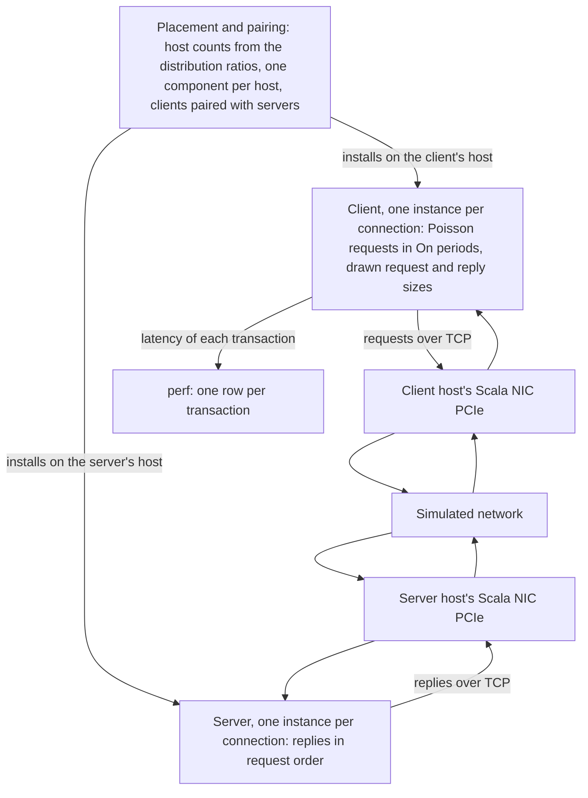

The Scala Traffic Generator generates TCP request and reply traffic between pairs of hosts, with Poisson arrivals, random message sizes, and bursts.

Model version 3.5.0 is the version these pages describe.

## What this model simulates

The Scala Traffic Generator is an application model for simulations that do not replay Chakra traces. It has two components: the client, which sends requests, and the server, which answers them. Before the simulation starts, the platform assigns every host (a server node of the configuration's topology) one of the two components, in the proportions the distribution ratios set, and pairs each client with a server on another host. On these pages, "server" on its own means the Traffic Generator's server component, not a host. Each pair has one or more connections. Each connection has its own instance of the client and of the server, and is one TCP connection.

On each connection, the client generates requests as a Poisson process at `RequestRate` requests per second, whether or not the replies to earlier requests have arrived. For each request it draws a request size and a reply size, and the server answers each complete request at once with a reply of the size the client drew. Requests can come in bursts: On periods of `BurstOnCycleTime` alternate with Off periods of `BurstOffCycleTime`, in which the client generates no requests. For every transaction, the client records the time from generating the request to receiving the last byte of the reply.

The results you reason about with it are transaction latencies under an open-loop load, including the time requests and replies wait in TCP. With TCP statistics turned on, you can also follow how each connection's congestion window, round-trip time, and retransmissions evolve in the topology.

The Scala Traffic Generator runs on hosts that all have a Scala NIC PCIe (platform model `ScalaNicPcie`). It cannot share a simulation with the [Scala RDMA application](../scala-rdma-application/index.md) or the [Chakra workload](../chakra-workload/index.md).

Simulations on the platform carry IPv4 traffic.

## Features

- **TCP request and reply transactions.** Each transaction is a request of a drawn size from the client and a reply of a drawn size from the server, on one TCP connection. The server replies in request order, as soon as each request has fully arrived. See [Transactions](./traffic-generation.md#transactions).
- **Open-loop Poisson requests.** Each connection generates requests with exponentially distributed gaps of mean 1 / `RequestRate` seconds, without waiting for replies, so requests and replies queue behind each other on the connection. See [Transactions](./traffic-generation.md#transactions).
- **TCP transport.** Each connection runs TCP CUBIC with selective acknowledgments and window scaling, Nagle's algorithm off, and a 20 ms minimum retransmission timeout: the platform's default TCP settings. See [TCP](./traffic-generation.md#tcp).
- **Request and reply size distributions.** Sizes are `constant`, `uniform`, or `normal`, each bounded by a minimum and a maximum, and configured separately for requests and replies. See [Request and reply sizes](./traffic-generation.md#request-and-reply-sizes).
- **On and Off bursts.** `BurstOnCycleTime` and `BurstOffCycleTime` alternate periods with requests and periods without them, on each connection's own cycle. See [Burst cycle](./traffic-generation.md#burst-cycle).
- **Several connections per pair.** `NumConnections`, from 1 to 8, sets the number of independent TCP connections between a client and each server it is paired with, each with its own requests at the full `RequestRate`. See [Connections](./traffic-generation.md#connections).
- **Placement and pairing by ratio.** The distribution ratios set how many hosts run the client and how many run the server; every host runs one of the two, never both, and pairing is random and repeatable for a given `RandomSeed`. See [Placement and pairing](./traffic-generation.md#placement-and-pairing).
- **Start types.** `StartType` spreads the connections' starts across the client start window: all at once, at independent random times, or evenly spaced. See [Start types](./traffic-generation.md#start-types).
- **Statistics.** One `perf` row for each transaction completed in the recording window, with its latency; running counts of requests and replies in the beacon record; and, when turned on, periodic TCP statistics for every connection. See [Records](./traffic-generation.md#records).

## Architecture

The platform assigns and pairs the hosts before the simulation starts. In the simulation, each connection's client sends requests over TCP through its host's NIC, and the server on the paired host sends back the replies.

| Component | Responsibility | Configured by |
| --- | --- | --- |
| Placement and pairing | Runs before the simulation. Turns the distribution ratios into numbers of client and server hosts, gives every host one of the two components, and pairs each client with a server on another host. | [Distribution ratios](./configuration.md#distribution-ratios) |
| Client | One instance per connection. Opens a TCP connection to its server, generates requests in On periods, draws each request's and reply's size, measures each transaction's latency, and writes a `perf` row for each transaction completed in the recording window. | [Client](./configuration.md#client) |
| Server | One instance per connection, listening on its own port. Answers each complete request with a reply of the size the client drew, in request order. | [Server](./configuration.md#server) |

## How to read these pages

Read them in this order:

1. [Traffic generation](./traffic-generation.md): how hosts are assigned and paired, the run's timeline, how requests, replies, sizes, and bursts work, the TCP settings, how a run ends, and the records a run writes, with worked examples of placement, timing, sizes, and bursts.
2. [Configuration](./configuration.md): every attribute that changes a run, with its type and default, how to add the application and change its values through the platform API, and the rules that stop a simulation.
