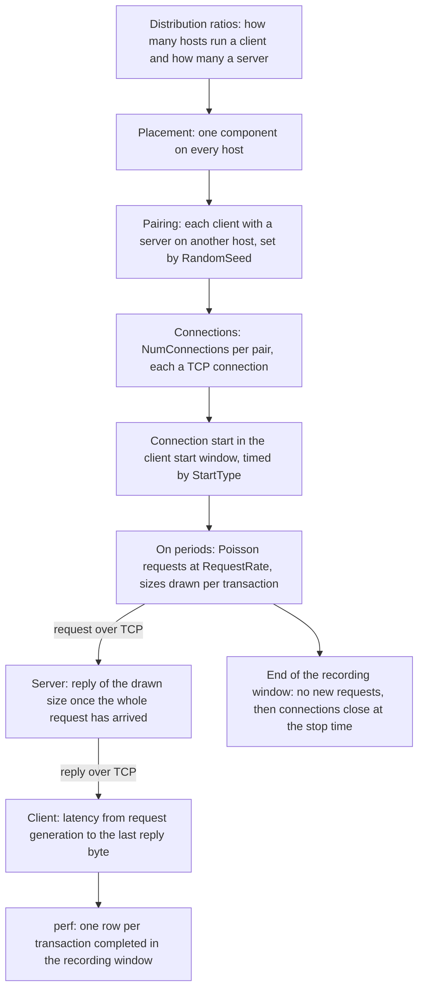

This page follows the Scala Traffic Generator through a run: where it runs, how requests and replies flow, and what it records.

Before the simulation starts, the platform places the clients and servers on the hosts and pairs them. In the simulation, each connection starts in the client start window, generates requests in On periods until the end of the recording window, and records the latency of every transaction completed in that window. [Configuration](./configuration.md) lists the attributes this page refers to, and [the overview](./index.md) summarizes the model.

## Overview



## Placement and pairing

Before the simulation starts, the platform decides how many hosts run the client and how many run the server, assigns the hosts, and pairs them. A host is a server node of the configuration's topology. On these pages, "server" on its own means the Traffic Generator's server component, not a host.

### Host counts

Each component has a distribution ratio: `prScalaTrafficGenerator` for the client and `prScalaTrafficServer` for the server ([Distribution ratios](./configuration.md#distribution-ratios)). The number of hosts that run each is:

```text
hosts running a component = floor(ratio x hosts), and at least 1 for a ratio above 0
```

If these counts add up to fewer than the hosts, each component whose share is still below its ratio gets one more host, in turn and starting with the client, until every host runs one component. A host therefore runs the client or the server, never both.

The ratios of all the applications in a configuration share one budget, and they must add up to 1. A ratio of 0 makes the configuration invalid. When you add an application, the platform splits 1.0 evenly over every client and server entry of every application in the configuration, so the Scala Traffic Generator on its own gets 0.5 for the client and 0.5 for the server.

### Pairing

Each client is paired with a server on another host:

1. Each client in turn takes a server that no other client has yet, picked at random.
2. Once every server has a client, each further client picks any server at random, so a server can serve several clients.
3. If servers are left over because there are more servers than clients, each of them gets a client picked at random, so a client can have several servers.

Pairing is random and set by the global simulation parameter `RandomSeed` (default `18760`): the same configuration with the same seed gives the same pairs. Each pair has its own connections ([Connections](#connections)).

### Worked example: 16 hosts

```text
Ratios 0.5 and 0.5 (the application on its own, as added), 16 hosts
  clients     floor(0.5 x 16) = 8
  servers     floor(0.5 x 16) = 8                    8 + 8 = 16 hosts, no top-up
  pairing     each client takes a different server: 8 pairs

Ratios 0.9 and 0.1, 16 hosts
  clients     floor(0.9 x 16) = floor(14.4) = 14
  servers     floor(0.1 x 16) = floor(1.6)  = 1      14 + 1 = 15 hosts
  top-up      clients hold 14 / 16 = 0.875, below 0.9: clients = 15
              (servers, at 1 / 16 = 0.0625, are below 0.1 too, but the
              client comes first and takes the last host)
                                                     15 + 1 = 16 hosts
  pairing     all 15 clients pair with the one server: 15 pairs

Ratios 0.25 and 0.75, 16 hosts
  clients     floor(0.25 x 16) = 4
  servers     floor(0.75 x 16) = 12                  4 + 12 = 16 hosts, no top-up
  pairing     each client takes a different server: 4 pairs
              each of the other 8 servers gets a client picked at random:
              8 more pairs, 12 in all, and each client has 3 servers on average
```

## Connections

The client's `NumConnections` (default `8`, from 1 to 8) sets the number of connections each pair has. Each of the N connections has its own client instance on the client's host and its own server instance, listening on its own port, on the server's host, and is one TCP connection between them. The connections are independent: each has its own start time, its own requests at the full `RequestRate`, its own burst cycle, and its own rows in the records. A client paired with several servers has `NumConnections` connections to each.

## Run timeline

Six global simulation parameters set the run's timeline. They are not attributes of this model: they sit in the configuration's `SimulationParameters` and are changed with `PATCH /api/v1/configurations/{config_id}/parameters` ([Change the global simulation parameters](./configuration.md#change-the-global-simulation-parameters)). Times are in seconds of simulation time.

```text
servers start         at StartTime
client start window   from StartTime + ClientStartOffset, lasting ClientStartInterval
recording window      from the end of the client start window + WarmUp, lasting RunTime
stop time             the end of the recording window + CoolDown
```

The servers start listening at `StartTime`. Each connection starts at a time in the client start window that `StartType` sets ([Start types](#start-types)), and generates requests until the end of the recording window. Only transactions whose replies complete in the recording window are recorded ([How a run ends](#how-a-run-ends)).

### Start types

The client's `StartType` sets when each connection starts, that is, when its client opens the TCP connection and generates its first request:

| `StartType` | When each connection starts |
| --- | --- |
| `uniform` (default) | Each connection at its own random time in the window, drawn independently and uniformly. |
| `simultaneous` | Every connection at the start of the client start window. |
| `sequential` | One connection after another, evenly spaced across the window, the first at its start. When the simulation runs as several simulator processes, each process spaces its own connections across the window. |

### Worked example: the default timeline

The defaults are `StartTime` 0.001, `ClientStartOffset` 0.001, `ClientStartInterval` 0.001, `WarmUp` 0.002, `RunTime` 0.5, and `CoolDown` 0.001.

```text
servers start         0.001 s
client start window   0.001 + 0.001 = 0.002 s   to   0.002 + 0.001 = 0.003 s
recording window      0.003 + 0.002 = 0.005 s   to   0.005 + 0.5   = 0.505 s
stop time             0.505 + 0.001 = 0.506 s
```

With the default `StartType`, `uniform`, each connection starts at its own random time between 0.002 s and 0.003 s. Transactions whose replies complete from 0.005 s to 0.505 s are recorded, no request is generated after 0.505 s, and the connections close at 0.506 s.

## Transactions

On each connection, the client generates requests as a Poisson process: the gap before each next request is drawn from an exponential distribution with mean 1 / `RequestRate` seconds, 2 ms at the default 500 requests per second. The first request is generated as soon as the connection starts, while TCP is still opening the connection. Requests are generated whether or not the replies to earlier ones have arrived (an open loop), and only during On periods ([Burst cycle](#burst-cycle)).

Each transaction goes through these steps:

1. **Request.** The client draws a request size and a reply size ([Request and reply sizes](#request-and-reply-sizes)) and hands the request to TCP as one write of the request size. TCP sends a connection's requests in the order they were generated, so a request waits behind the ones before it.
2. **Reply.** Once the whole request has arrived, the server replies at once, with no processing time, with a reply of the size the client drew. It answers a connection's requests in the order they were sent, so a reply waits behind the replies to earlier requests.
3. **Completion.** The transaction completes when the last byte of the reply reaches the client.

Requests and replies carry only their drawn sizes as payload: the reply size reaches the server with the request without adding bytes to it.

```text
requests per second, per connection, in On periods   = RequestRate
per client and server pair                           = NumConnections x RequestRate
with the defaults                                    = 8 x 500 = 4,000 requests per second
```

### Latency

A transaction's latency runs from the moment the client generates the request to the arrival of the last byte of the reply at the client. It includes the time the request waits in TCP behind earlier requests, the transfers in both directions, the time the reply waits behind replies to earlier requests, and, for a connection's first request, the TCP handshake.

## Request and reply sizes

Each transaction draws its request size from `RequestSizeDistribution`, `RequestSizeMin`, `RequestSizeMax`, and `AverageRequestSize`, and its reply size from `ReplySizeDistribution`, `ReplySizeMin`, `ReplySizeMax`, and `AverageReplySize`. The same rules apply to both, where Min, Max, and Average are the matching attributes:

```text
constant   every size is Min
uniform    drawn uniformly between Min and Max; Average is not used
normal     drawn from a normal distribution with mean Average and standard
           deviation sqrt(2) x Max, drawn again until it lies within
           Average - Max through Average + Max; a negative value is made
           positive, and the size is drawn again until it is between Min and Max
```

With `normal`, the spread is broad: the standard deviation is wider than the Min-to-Max range. Sizes are whole bytes.

### Worked example: the default sizes

Both distributions default to `normal`.

```text
requests   Min 400, Max 3,000, Average 1,500
           standard deviation   sqrt(2) x 3,000 = 4,243 bytes
           drawn within         1,500 - 3,000 = -1,500   through   1,500 + 3,000 = 4,500
           kept                 400 to 3,000 bytes; any other draw is drawn again

replies    Min 1,000, Max 10,000, Average 6,000
           standard deviation   sqrt(2) x 10,000 = 14,142 bytes
           drawn within         6,000 - 10,000 = -4,000   through   6,000 + 10,000 = 16,000
           kept                 1,000 to 10,000 bytes; any other draw is drawn again
```

## Burst cycle

On each connection, requests come in On periods separated by Off periods:

1. An On period starts with a request.
2. Further requests follow at the drawn gaps until the gaps drawn since the period began add up to `BurstOnCycleTime` or more. The time the last gap points to starts the Off period instead of a request.
3. The Off period lasts `BurstOffCycleTime`, with no new requests. Then the next On period starts.

Each connection's cycle starts at the connection's own start time. Transactions in flight continue through an Off period: requests already sent are answered, and their replies arrive and are recorded. With `BurstOffCycleTime` at `0`, the default, the next On period starts at once, so requests arrive as one continuous Poisson process at `RequestRate`.

With `BurstOnCycleTime` and `BurstOffCycleTime` converted to seconds:

```text
requests per On period, on average   = 1 + RequestRate x BurstOnCycleTime
On period, on average                = BurstOnCycleTime + 1 / RequestRate
requests per second over many cycles = requests per On period / (On period + BurstOffCycleTime)
```

### Worked example: requests per On period

```text
defaults: RequestRate 500 per second, BurstOnCycleTime 100 ms, BurstOffCycleTime 0
  requests per On period   1 + 500 x 0.100 = 51
  requests per second      500, continuous

RequestRate 500 per second, BurstOnCycleTime 50 ms, BurstOffCycleTime 50 ms
  requests per On period   1 + 500 x 0.050 = 26
  On period                0.050 + 1 / 500 = 0.052 s
  requests per second      26 / (0.052 + 0.050) = 254.9, about half the rate in On periods
```

## TCP

Each connection is a TCP connection with the platform's default TCP settings:

| Setting | Default |
| --- | --- |
| Congestion control | TCP CUBIC |
| Segment size | 1,460 bytes |
| Send and receive buffers | 4 MB (4,000,000 bytes) each |
| Initial congestion window | 10 segments |
| Delayed acknowledgment | An ACK every 2 segments, or after 4 ms |
| Nagle's algorithm | Off |
| Selective acknowledgment (SACK) | On |
| Minimum retransmission timeout | 20 ms |
| Window scaling | On |
| Timestamps | Off |

The application's packets carry DSCP 0, so switches put them in traffic class 0.

## How a run ends

At the end of the recording window, the clients stop generating requests and the servers stop sending replies. A transaction whose reply completes after the end of the recording window is not recorded. The connections close at the stop time, when the simulation ends.

## Records

### Records a simulation writes

With the defaults, the Scala Traffic Generator writes these records. Each file is named after the record, in the form `{simulation-name}-{record}-{shard-index}.csv`, as [Simulation output files](../../simulation-output-files.md#file-naming-convention) describes. When a simulation runs as several simulator processes, each process writes its own shard, covering the instances that process ran.

| Record | One row for | When |
| --- | --- | --- |
| `perf` | Each transaction whose reply completes in the recording window | As each transaction completes |
| `beacon` | Each report interval | Every `BeaconReportInterval`; the application adds to six of its columns |

`tcp-stats` is written only when turned on ([tcp-stats](#tcp-stats)).

`BeaconReportInterval` is a global simulation parameter, not an attribute of this model: a `double` in seconds (default `0.001`) in the configuration's `SimulationParameters`.

### perf

**`perf`** has one row for each transaction whose reply completes in the recording window, both ends of the window included, written by the client when the last byte of the reply arrives. The server writes no rows. The columns are:

| Column | Holds |
| --- | --- |
| `job_id` | The simulation job's identifier |
| `time_utc` | Wall-clock time the row was written |
| `sim_time_sec` | Simulation time the transaction completed, in seconds |
| `metric_name` | The client's `ServerType`, `ScalaApp` |
| `perf_metric_usec` | The transaction's latency, in microseconds ([Latency](#latency)) |
| `metric_path` | `NAN` |
| `metric_aggregation_id` | `NAN` |
| `node_id` | The node id of the client's host in the simulation |
| `transaction_number` | The transaction's number on its connection, counting from 0 |
| `start_time_sec` | Simulation time the client generated the request, in seconds |
| `transfer_size_b` | `NAN` |
| `application_name` | The name of the connection's client instance; each connection has its own |

### Beacon

The **`beacon`** record writes running totals every `BeaconReportInterval`. The application adds to six of its columns:

- `tx_client`: requests the clients have handed to TCP since the start of the run.
- `rx_client`: replies the clients have received in full, that is, transactions completed, since the start of the run.
- `tx_server`: replies the servers have sent since the start of the run.
- `rx_server`: requests the servers have received in full since the start of the run.
- `rx_bytes_writer`: bytes of the requests the servers have received in full during the recording window.
- `goodput_writer_MB_per_sec`: the request bytes the servers receive per second, divided by the number of hosts that run a server, averaged over the report intervals of the recording window so far, in MB/s (1,000,000 bytes per second).

The application counts requests and replies in `tx_client`, `rx_client`, `tx_server`, and `rx_server`, not packets.

Each shard counts the instances its simulator process ran. [Simulation output files](../../simulation-output-files.md#beacon-beacon) lists the record's columns.

### tcp-stats

**`tcp-stats`** is written when the client's `EnableTcpStats` is `true`, its default, and the global simulation parameter `EnableTcpStackReporting` is `true`; that parameter's default is `false`, so the record is off until you set it ([Change the global simulation parameters](./configuration.md#change-the-global-simulation-parameters)). It has one row for each client connection every `TcpStackReportInterval` of simulation time (a global simulation parameter, default `0.1` s), starting one interval after the first connection starts. Its columns, by group:

| Columns | Hold |
| --- | --- |
| `job_id`, `time_utc`, `sim_time_sec` | The simulation job, the wall-clock time the row was written, and the simulation time of the report, in seconds |
| `AppId`, `Type` | The connection's client instance, named as in the `application_name` column of `perf`, and `CLIENT` |
| `CongestionWindow`, `CongestionWindowInflated`, `RWND`, `AdvWND`, `BytesInFlight`, `SlowStartThreshold` | The connection's congestion, receive, and advertised windows, the bytes it has in flight, and its slow start threshold |
| `RTO`, `RTT` | The retransmission timeout and the round-trip time, in microseconds |
| `State`, `CongState`, `NACKSRecvd`, `TotalSegmentsTX`, `OPEN`, `DISORDER`, `CWR`, `RECOVERY`, `LOSS`, `NumRTO`, `NumFastRetrans`, `DupAcksOrSacks` | The connection's TCP state and congestion state, and its counters, among them the congestion states it has entered, retransmission timeouts, fast retransmissions, and duplicate ACKs or SACKs |
| `total_bytes_tx_GB`, `tx_interval_throughput_rate_MBps`, `total_bytes_rx_GB`, `rx_interval_throughput_rate_MBps` | The bytes the connection has sent and received since it started, in GB (1,000,000,000 bytes), and its send and receive rates over the last interval, in MB/s (1,000,000 bytes per second). They count TCP payload, retransmissions included |

### Getting the records

`GET /api/v1/simulations/{sim_id}/results` lists a simulation's result files, among them every record on this page; its `type` query parameter filters by file type, for example `csv`. `GET /api/v1/simulations/{sim_id}/results/download-url`, with the `fileName` query parameter set to a file's name, returns a link to download that file. The [Simulations API reference](../../api-reference/simulations.md#get-simulation-results) lists their parameters.

`GET /api/v1/simulations/{sim_id}/results/data` with `metric=perf` also summarizes the `perf` files on the platform ([Simulation output files](../../simulation-output-files.md#performance-metrics-perf)).

Set `SIM_ID` to the simulation's ID and `FILE_NAME` to a name from the list:

```bash
curl -X GET "https://api.scalacomputing.com/api/v1/simulations/$SIM_ID/results?type=csv" \
  -H "Authorization: Bearer $SCALA_API_TOKEN"

curl -X GET "https://api.scalacomputing.com/api/v1/simulations/$SIM_ID/results/download-url?fileName=$FILE_NAME" \
  -H "Authorization: Bearer $SCALA_API_TOKEN"
```
